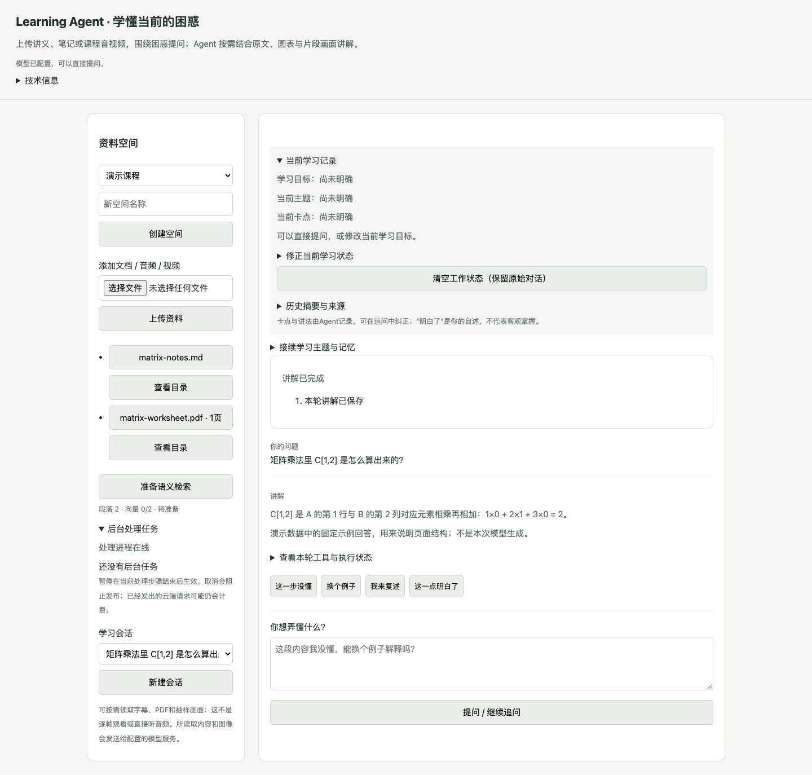
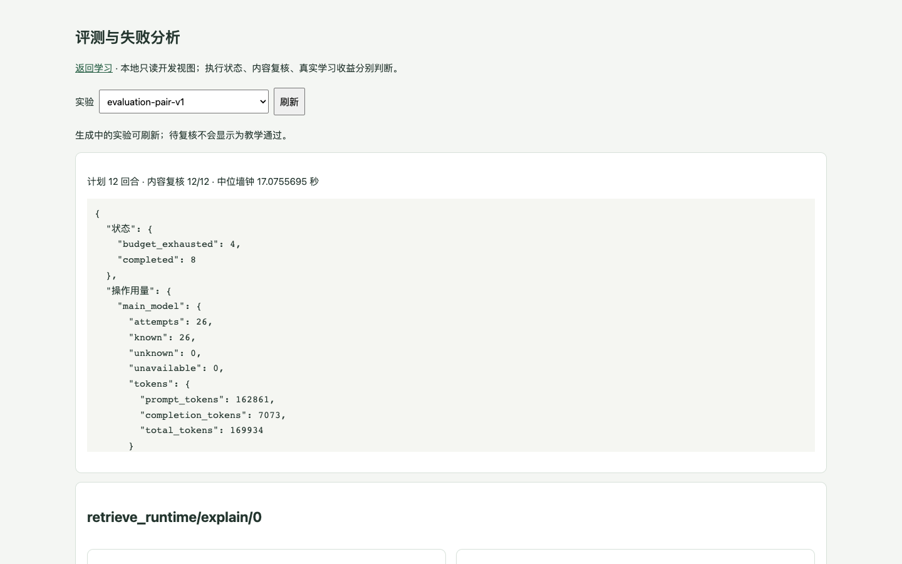

# Learning Agent

> 本地优先的多模态学习 Agent：把文字、PDF、音视频资料变成可追问、可回查的讲解。

Learning Agent 面向在长课程、讲义和个人资料里自学的场景。你可以上传资料、提出具体困惑，Agent 会自己决定直接解释、先澄清、搜索、补读上下文，或者实际打开某一页 PDF、读某段字幕、看几个视频帧，最后给出带来源位置的讲解。

它不把“检索结果拼接”当作答案，也不要求每轮都走固定 RAG 流程；检索、播放器和时间定位都服务于“讲清楚”和“能回去核对”。

## 核心能力

- **多模态资料**：文字、PDF、音频、视频；PDF 支持物理页码和区域查看，扫描页可识别文字层，视频支持字幕与抽样画面。
- **Agent 自主工具调用**：模型根据问题和工具观察选择解释、澄清、搜索、补读、看页或看帧，而不是固定检索后生成。
- **可选自动路由**：简单问题走直答或固定检索，涉及页面、图表、视频、反馈或选中位置时回到完整 Agent，保留同一套 Runtime 与记录。
- **连续学习**：保存当前目标、卡点、讲解尝试和用户反馈；支持主题接续与可管理的跨会话记忆。
- **可恢复执行**：问题提交后后台执行，网页显示真实进度；刷新、断线或进程重启后按检查点恢复，可取消，可查看草稿。
- **本地检索**：中文二元词与英文词 BM25，叠加多语言向量（默认走本机 ollama 的 `bge-m3`，可切进程内 ONNX 或 OpenAI 兼容接口），RRF 融合，交叉编码器精排（默认开启）；向量或精排不可用时明确退回上一级并说明原因。92 题标注集（7 讲整讲 8.8 小时 + 三份讲义，942 个分块、83 道可评分）上 Hit@5：BM25 0.40 → 混合 **0.64** → **加精排 0.81**（向量 `bge-m3`、精排 `bge-reranker-v2-m3-int8`）。换模型差别很大——进程内 ONNX 回退用的 384 维小模型，混合只有 0.55，所以报数字必须带模型名。精排不能替代向量召回：只给 BM25 候选加精排是 0.55。历史口径见[检索口径沿革](docs/retrieval-history.md)。
- **可评测**：固定 Dataset、逐尝试证据、规则/人工复核、baseline/candidate 对比、只读评测页，以及冻结基线与退化门禁。

## 界面

学习工作区：资料空间、连续提问、工具进度、来源回跳和评测入口。



评测查看页：按实验查看执行状态、模型/工具操作量、Token 与逐回合结果。



截图来自本机演示数据，不是预写动画。

## 快速开始

### 环境要求

- Python 3.12–3.13
- [uv](https://docs.astral.sh/uv/)
- 音视频处理需要系统安装 `ffmpeg` 和 `ffprobe`（macOS：`brew install ffmpeg`；文字/PDF 不需要）
- 一个 OpenAI 兼容的模型服务地址、模型 ID 和 API key

### 安装

```bash
git clone https://github.com/canglang007/learning-agent.git
cd learning-agent
uv sync --extra dev
cp .env.example .env
```

可选能力按需加装，不装不影响文字和数字版 PDF 的问答：

| 附加项 | 命令 | 用途 |
| --- | --- | --- |
| `asr` | `uv sync --extra dev --extra asr` | 本地语音转写（默认 provider 为 `local`） |
| `ocr` | `uv sync --extra dev --extra ocr` | 识别 PDF 扫描页的文字 |
| `embed` | `uv sync --extra dev --extra embed` | 交叉编码器精排；以及 `local` 向量来源（进程内 ONNX）。默认向量来源是 ollama，不依赖这一项 |

缺少附加项时对应入口返回安装提示，不会让后台任务静默失败。

编辑 `.env`，至少填写：

```dotenv
LA_BASE_URL=https://your-gateway.example/v1
LA_MODEL=your-model-id
LA_API_KEY=your-key
LA_PROTOCOL=chat_completions
```

也可以让终端向导写入配置（密钥隐藏输入，只保存在本机 `.env`）：

```bash
./start.sh --configure
```

### 启动

```bash
./start.sh
```

启动后会同时运行 API 和媒体 worker，并打开：

- 学习工作区：<http://127.0.0.1:8320>
- 评测查看页：<http://127.0.0.1:8320/evaluation>

`Ctrl-C` 会结束本次启动的两个进程。常用参数：

| 参数 | 说明 |
| --- | --- |
| `--port 8320` | 指定端口；端口被占用时不会结束已有服务 |
| `--data-root ./data` | 指定数据目录；API 与 worker 必须一致 |
| `--evaluation-root ./data/evaluations` | 指定评测报告根目录 |
| `--doctor` | 只做本地配置检查，不调用模型 |
| `--configure` | 重新填写模型服务、模型 ID、协议和密钥 |
| `--no-browser` | 启动后不自动打开浏览器 |

没有 API key 时不会调用模型，但仍可浏览已有资料和对话。模型调用会产生费用，是否计费取决于你配置的服务。

### 使用自包含演示数据

想先看界面和交互，可以生成一个不依赖私有课程文件的演示工作区：

```bash
uv sync --extra dev
uv run python examples/prepare_demo.py --output data/demo-public
./start.sh --data-root data/demo-public
```

脚本生成合成笔记、合成 PDF 和一条固定示例会话，不调用模型；示例回答会明确标注为演示数据。新提问仍需要配置模型。这套离线演示只覆盖文字/PDF，不含视频。

### 真实课程多模态演示

想直接看 PDF 页面 + 视频字幕 + 抽样帧的真实流程，使用本机已有的课程素材：

```bash
uv run python examples/prepare_course_demo.py \
  --output data/demo \
  --workspace data/demo/workspace-multimodal
./start.sh --data-root data/demo/workspace-multimodal --evaluation-root data/evaluations
```

演示使用真实 CS336 讲义第 10 页、198 秒课程视频和本地 ASR 字幕；素材只在本地，不随仓库分发。完整顺序、已验证运行和边界见[真实课程多模态演示](docs/demo.md)。没有课程素材时使用上面的离线演示，或在网页上传自己的 PDF/视频。

### 手动启动（开发）

API 和 worker 也可以分别运行，便于调试：

```bash
uv run uvicorn learning_agent.app:create_app --factory --host 127.0.0.1 --port 8320
```

另开一个终端：

```bash
uv run python -m learning_agent.worker
```

两个进程必须使用同一个数据目录。只启动 API 时，后台回放、转写和索引任务会保留，网页会显示处理进程离线。

### Docker（可选）

```bash
cp .env.example .env
# 在 .env 填 LA_BASE_URL / LA_MODEL / LA_API_KEY / LA_PROTOCOL
docker compose up --build
```

打开 <http://127.0.0.1:8320>。API 与 worker 共享 `./data`，`Ctrl-C` 结束；不需要在本机安装 Python 或 ffmpeg。Docker daemon 未启动时继续使用 `./start.sh`。

**容器里的向量来源要另外说清楚。** 默认是 `ollama` + `bge-m3`，而容器内的
`localhost` 是容器自己，连不到宿主机的 ollama。两种做法任选：

```bash
# A. 用宿主机的 ollama（macOS / Windows 的 Docker Desktop 可直接用这个主机名）
LA_EMBEDDING_BASE_URL=http://host.docker.internal:11434

# B. 不装 ollama：改用镜像内的 ONNX 模型（已带 embed 扩展；回退口径混合 0.55，比 bge-m3 低 8.5pt）
LA_EMBEDDING_PROVIDER=local
LA_EMBEDDING_MODEL=sentence-transformers/paraphrase-multilingual-MiniLM-L12-v2
```

两者都不设时不会静默降级：检索状态里会写明 `dense_status=embedding_request_failed:*`，
界面按关键词检索结果展示，精排仍然生效。

### 给别人试用

`./start.sh` 只监听 127.0.0.1。要让别人打开链接用，两件事缺一不可：先决定谁能进来，再把地址暴露出去。

推荐开账号模式：同学用邀请码自己注册，登录后只看得到自己的会话和学习记录。

```bash
# .env 里写一行
LA_AUTH=accounts
# 起服务后发邀请码（可多人共用一个码）
uv run python scripts/accounts.py invite --note 试用 --uses 10
# 监听所有网卡
./start.sh --host 0.0.0.0
```

只想临时挡一下无关访问，也可以退回共享口令：`LA_AUTH=code` 加 `LA_ACCESS_TOKEN`（`python3 -c 'import secrets; print(secrets.token_urlsafe(9))'`）。两种情况都没配就没有登录页——不假装受保护。

账号、邀请码、重置密码都在 `scripts/accounts.py`：`list` 看注册情况，`passwd` 重置密码并踢掉旧登录态，`disable` 停用某个账号而不动数据。

放到云服务器上长期跑，见 [docs/deploy.md](docs/deploy.md)。整条路径就是 `./deploy/pack.sh` 打一个 31 M 的包，传上去解压，填 `.env`，跑 `./deploy/install.sh`。

试用结束后问卷结果单独导出：`uv run python -m learning_agent.survey --workspace data --output survey.json`。

## 使用流程

1. 新建资料空间，上传文字、PDF 或音视频。
2. 新建会话，直接提问；需要时先在阅读器中选中 PDF 页码或视频时间段。
3. 展开回答下的工具记录，查看 Agent 实际读过哪一页、哪段字幕或哪几帧，并点击来源回到原位置。
4. 用“这一步没懂 / 换个例子 / 我来复述 / 这一点明白了”反馈，或继续自由追问。
5. 音视频默认用本地 ASR 转写；也可直接上传字幕（SRT / VTT / ASS / SSA / TTML / SBV 等），或改用兼容 API。
6. 需要比较改动效果时，打开 `/evaluation` 或使用评测 CLI。

### 支持的资料

| 类型 | 当前支持 | 说明 |
| --- | --- | --- |
| 文字 | 上传、分段、行号阅读 | txt / md / rst / tex / csv / tsv / json 等纯文本；适合笔记、讲义转写文本 |
| PDF | 20 MB / 200 页；物理页码、页内文字、整页/区域图像 | 扫描页按需识别：读到哪页识别哪页，只让它可读；要整本可搜再显式识别（需 `uv sync --extra ocr`），公式与版面仍靠看图 |
| 音视频 | 默认 2 GiB / 4 小时；字幕、抽样帧、回放 | 容器与编码由 ffprobe 判定，不靠扩展名：能直接播就原样提供，只差容器就 remux，编码真不兼容或超 4K 才转码。浏览器自己解不了（如 Safari 上的 AV1）时前端会按 `canPlayType` 结果要求一份 H.264 预览，不会让你对着黑屏猜。不是连续逐帧观看，也不直接理解音频 |
| 字幕 | SRT / VTT / ASS / SSA / TTML / SBV / SUB；本地或兼容 API ASR | 非 UTF-8 或非 SRT/VTT 的字幕由 ffmpeg 统一转换，不要求用户先转格式；已有字幕优先，ASR 可能误识别术语 |
| 检索 | BM25；进程内多语言向量 + RRF（也可接 ollama / 兼容 API） | 未配置向量或索引故障时明确退回词法 |

更细的格式、恢复和验收边界见下方文档。

## 配置

所有配置使用 `LA_` 前缀，完整示例见 [.env.example](.env.example)。最常用的几项：

| 变量 | 默认值 | 用途 |
| --- | --- | --- |
| `LA_BASE_URL` | `https://api.openai.com/v1` | OpenAI 兼容服务地址；换成你自己的网关 |
| `LA_MODEL` | `gpt-4o-mini` | 模型 ID；按你的网关实际支持的型号填写 |
| `LA_API_KEY` | 空 | 模型服务密钥；不要提交到仓库 |
| `LA_PROTOCOL` | `chat_completions` | `chat_completions` 或 `responses` |
| `LA_ROUTE_POLICY` | `agent` | `agent` 始终走完整 Agent；`auto` 启用自动直答/固定检索 |
| `LA_DATA_ROOT` | `./data` | 资料、数据库和产物目录 |
| `LA_STREAM_ANSWER` | `false` | 是否显示正文草稿流（进度 SSE 不受影响） |
| `LA_ASR_PROVIDER` | `local` | `local` / `compatible` / `disabled`；`local` 需装 `asr` 附加项 |
| `LA_OCR_ENABLED` | `true` | 是否识别 PDF 扫描页；需装 `ocr` 附加项。默认按需识别被读到的页 |
| `LA_OCR_ON_UPLOAD` | `false` | 上传后整本识别并加入检索；关闭时只有被读到的页会识别，且不进索引 |
| `LA_EMBEDDING_PROVIDER` | `disabled` | `ollama` / `compatible` / `disabled` |
| `LA_MEDIA_MAX_BYTES` | 2 GiB | 单份媒体大小上限 |
| `LA_MEDIA_MAX_SECONDS` | 4 小时 | 单份媒体时长上限 |

协议、视觉、ASR、向量和上下文预算的具体能力依赖服务商与型号，不能只凭模型名推断；以实际探测和文档中的验证边界为准。

## 开发与测试

```bash
uv run pytest -q
uv run ruff check .
```

CI 每次 push / pull request 跑公开检查、pytest、ruff、评测完整性检查和 Docker build。评测完整性检查只看任务集和基线的结构，不调模型。质量门禁要冻结报告，本地显式跑。

评测 CLI：

```bash
uv run python -m learning_agent.evaluation --help
# 改动后：把已有报告判定为通过 / 退化 / 不可比 / 复核不足
uv run python -m learning_agent.evaluation gate \
  --baseline evals/quality-baseline.json --experiment data/evaluations/my-run
# 题从哪来：从真实使用里挖回归候选，只读、不调用模型、gold 留空给人补
uv run python -m learning_agent.evaluation mine-feedback \
  --workspace data/demo/workspace --output data/feedback/candidates.json \
  --queue data/feedback/queue.json
```

候选进队列后，用 `review-candidate` 定状态并补 gold，`promote-cases` 把接受的并进新版本任务集。三步的规则见 [评测闭环](docs/evaluation-loop.md)。

基线与结果表（无检索直答、固定 RAG 对比）见 [统一评测](docs/evaluation.md) 的“基线与结果表”；本机试点结果见 [评测结果](docs/evaluation-results.md)；评测结果怎么回到开发、怎么防止改坏，见 [评测闭环](docs/evaluation-loop.md)。

## MCP（可选）

```bash
uv sync --extra mcp
uv run learning-agent-mcp --data-root ./data --space <space_id>
```

服务器通过 stdio 暴露三个只读工具：`list_materials`、`search_materials`、`read_page`。它不调用模型、不上传、不修改资料；搜索只读取已有分段，PDF 只返回提取文字。完整配置、真实 PDF 演示和边界见 [MCP 只读服务器](docs/mcp.md)。

`examples/` 下提供了文字、PDF、媒体、长课程、检索、恢复、流式和记忆等验收脚本；`examples/verify_demo_run.py` 用网页同一套 HTTP 接口跑一次演示提问，把路由、工具序列、已验证引用和每步上下文估算导出成本地证据文件。真实模型调用会产生费用，运行前请阅读对应文档。

### 项目结构

```text
src/learning_agent/
  app.py            FastAPI 入口、REST 与 SSE
  runtime.py        问答调度、状态机、取消与恢复
  run_store.py      运行提交、幂等与终态事务
  execution_store.py 检查点与外部操作账目
  agent.py          Agent 教学循环
  context.py        上下文预算、选择与摘要
  tools.py          资料读取、页面/视频查看与交付工具
  retrieval.py      BM25、向量与 RRF 检索
  memory.py         学习主题、接续设置与记忆
  store.py          SQLite 持久化
  worker.py         回放、ASR 与索引后台任务
  evaluation/       评测运行、采集、评分与对比

examples/           可运行示例与验收脚本
evals/              公开评测任务定义
tests/              工程回归测试
docs/               对外文档
data/               本机资料、数据库与运行产物（不提交）
notes/              自用设计与复盘笔记（不提交）
```

## 文档

| 文档 | 内容 |
| --- | --- |
| [问答执行与恢复](docs/agent-runtime.md) | 提交、进度、取消、检查点与恢复 |
| [上下文管理](docs/context-management.md) | 每步预算、协议归档与图片淘汰 |
| [学习状态与上下文设计](docs/learning-context-design.md) | 学习状态、摘要与记忆的整体设计 |
| [学习主题与记忆](docs/learning-memory.md) | 主题接续、记忆范围与遗忘 |
| [长课程导入与后台任务](docs/long-course-design.md) | 分块上传、回放、ASR 与恢复 |
| [长课程检索](docs/course-retrieval.md) | 分段、BM25/向量融合与验收结果 |
| [检索对照实验](docs/retrieval.md) | BM25 vs 单语小模型 vs 多语言模型，逐题排名与取舍 |
| [多模态评测](docs/multimodal-eval.md) | 分模态指标、两个被 any() 掩盖的标注缺陷、覆盖边界 |
| [统一评测](docs/evaluation.md) | Dataset、评分、基线对比与结果表 |
| [评测结果](docs/evaluation-results.md) | 自动路由与多模态基线的本机试点 |
| [评测闭环](docs/evaluation-loop.md) | 真实迭代案例、质量门禁与不可比/复核不足的判定 |
| [MCP 只读服务器](docs/mcp.md) | 向外部 MCP 客户端暴露资料工具 |
| [公开边界](docs/public-boundary.md) | 本机单用户、分享前检查与托管限制 |
| [自动路由](docs/routing.md) | 直答、固定检索与 Agent 的选择规则 |
| [真实课程多模态演示](docs/demo.md) | 3–5 分钟 PDF 页面 + 视频字幕/抽样帧 |
| [离线合成演示](docs/demo-offline.md) | 无课程素材时的文字/PDF 路径 |
| [演示流程](docs/demo.md) | 5–8 分钟真实学习流程与证据入口 |

## 隐私与数据

- API key 只写入本机 `.env`，接口不会返回明文。
- 原始资料、SQLite、图片、字幕和评测产物都在 `data/`，已被 `.gitignore` 排除。
- 自用设计与调试记录在 `notes/`，同样不提交。
- 提问时，选中的资料片段、字幕和图像会发送给你配置的模型服务；请按服务商的条款处理敏感资料。

## 当前状态

- 工程回归：299 项通过、1 项按条件跳过；CI 运行公开检查、pytest、ruff、评测完整性检查和 Docker build。
- 本地 Docker build/run 与 Compose 配置已验证；GitHub Actions 绿色。
- 已有自包含演示数据、自动路由、只读 MCP、基线结果表和 3–5 分钟演示脚本。
- 小型实例实测：1 核 1 GiB 上三路并发提问全部完成，进程常驻约 210 MB；耗时受模型服务影响明显（27–77 秒）。
- 提供邀请码注册的账号体系（scrypt 密码哈希、登录态存库）、会话与学习记忆按账号隔离；**没有**配额、账单上限和多租户计费。外部用户研究尚未进行，不宣称教学收益。

## 公开边界与许可

默认按本机单用户运行；要对公网开放需自行部署，开 `LA_AUTH=accounts`（或设共享口令），并在反向代理层补 https、限流和额度。应用内的登录只回答"谁能进来、这是谁"，不等于完整的公网防护。公开仓库前请运行 `uv run python scripts/check_public.py`，并阅读[公开边界](docs/public-boundary.md)。License: MIT。

## 当前边界

- 账号只做"谁能进、这是谁"：没有邮箱验证、找回密码、角色权限和多租户计费；忘记密码找部署者用 `scripts/accounts.py passwd` 重置。资料空间仍是共用的，会话、学习主题与记忆按账号隔离。
- 音视频理解是“字幕 + 抽样帧”，不是连续逐帧观看、直接听音频或说话人分离。
- ASR 可能断句、漏词或误识别专业术语；已有字幕优先，重要内容需要对照原文或画面。
- 扫描页 OCR 分两档：按需识别只让被读到的那一页可读，不进检索；整本识别才让它可搜。两档都只补“这页有没有文字”：标题和正文可用，公式、表格结构和版面关系仍会错，需要看图核对；不支持手写体和独立图片文件。
- 模型能力、协议和流式支持因服务商而异；Responses 与部分网关的组合仍以实际验证为准。
- 评测覆盖工程路径和开发过程复核，不宣称真人学习收益或教学通过率。

更新于：2026-11-23 19:10:00（Asia/Shanghai，UTC+08:00）
