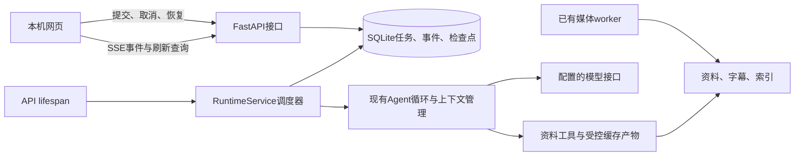

# 可恢复、可交互的问答执行模块设计

状态：设计完成，尚未实现。编写/更新于：2026-10-20 09:32（Asia/Shanghai，UTC+08:00）。代码审查基线：`0ef29ac`。本文的接口、数据表、默认值与验收任务均为拟定方案；当前可用行为以代码与README为准。

## 1. 目标与实际缺口

用户提交问题后能查看实际进度、刷新后继续查看、停止当前回答，并在服务重启后恢复有条件恢复的任务。运行恢复仍服务于准确讲解，不改变Agent根据观察自主选择工具的方式。

| 实际代码 | 当前行为 | 本轮设计要补足的能力 |
| --- | --- | --- |
| `app.py:ask` | HTTP请求直接等待`run_turn`完成 | 提交、执行与订阅分离 |
| `static/app.js:ask-form` | 一次POST等待最终JSON，本页`busy`管理交互 | 任务ID、实时事件、刷新后发现当前任务、取消和恢复入口 |
| `store.py:start_run` | 写入running和用户消息，同会话唯一running索引 | 幂等提交、多状态互斥及失效运行可处理 |
| `agent.py:run_turn` | 组、观察缓存、计数器和待提交状态主要在内存中 | 明确的执行游标与持久检查点 |
| `context_snapshots` | 记录输入选择、估算和usage | 继续保留诊断职责，另存可恢复执行状态 |
| `store.py:finish_run` | 同事务保存答案、档案与学习状态；没有运行所有者检查，状态更新未检查CAS影响行数 | 幂等终态提交，校验所有权、取消及状态版本 |
| `provider.py:send` | 一次非流式请求；网络错误合并为ModelError | 请求意图、结果已落库/结果未知区分，之后再增加正文流式 |
| `summaries.py:maybe_summarize` | 另有一次可能计费的模型请求，独立保存摘要尝试 | 同步纳入取消、远端调用记录和恢复规则 |
| `retrieval.py:search` | 混合检索可在工具内部调用本地或兼容API的query embedding | 云端向量请求也需记录，不能把所有读取工具都当成可无条件重做 |
| `Store.page_image/media_frame` | 读资料时会生成缓存图片，部分路径直接写最终文件 | 原子发布派生产物，取消或崩溃不留下可被误读的半文件 |
| `jobs.py/worker.py` | 已实现媒体、ASR、索引任务及恢复 | 保持独立；可参考事务和所有者校验，不把教学循环塞入阻塞式媒体队列 |

现有`except (ModelError, TimeoutError)`不覆盖进程退出或所有取消路径，可能在`finish_run`前留下running记录。已有档案能说明发生过什么，尚不能可靠恢复执行。现有95项测试是代码基线成绩，不是本模块验收结果。

## 2. 用户流程与部署选择

正常流程：发送问题 → 立即获得任务卡 → 看见实际模型/工具进展 → 显示经校验的最终讲解 → 继续追问。刷新或关闭网页不取消任务；重开网页查询服务端当前任务并补读事件。网页断线显示“连接中断，正在重新连接”，不能据此把后台任务标为失败。

点击“停止本轮”立即显示取消请求；收到执行器确认后显示“已停止”。模型请求或同步工具正在结束时显示“正在停止”，不伪装为立即撤销。中断任务显示恢复原因与可用动作；用户可“继续执行”“重试本次模型请求”或“结束此轮，重新提问”，仅显示实际允许的操作。

初版沿用本机单用户、macOS/Linux、一个Uvicorn API进程和已有媒体worker：

`RuntimeService`由FastAPI lifespan启动和关闭，持有所有后台Task的强引用、回收异常并定期查询SQLite。唤醒通知用于降低延迟，数据库才是任务事实；不依赖单次HTTP请求或响应后的临时BackgroundTasks。[FastAPI lifespan说明](https://fastapi.tiangolo.com/advanced/events/)、[Python任务生命周期说明](https://docs.python.org/3.13/library/asyncio-task.html#creating-tasks)。

同一数据目录由一个`.runtime.lock`操作系统文件锁保护问答调度器，与已有`.worker.lock`区分。初版要求`--workers 1`；第二个问答调度器启动失败并给出可读提示，不靠心跳超时强行抢占仍存活的进程。API关闭时调度器也停止；服务重启后读检查点恢复，不承诺API停机期间继续执行。以后可把同一调度器移到独立进程，本轮不增加第三个必需启动命令。

拟定默认同时执行1个问答、最多排队20个；不同会话可以排队，同一会话保留一个待处理任务。队列满返回503及重试提示，不写入半条用户消息。这些是初始资源边界，不是吞吐基准。现有统一启动与首次配置向导仍是后续交付工作。

## 3. 任务状态、会话互斥与幂等提交

沿用已有`runs.id`，保持网页来源、反馈、档案与运行ID关联。

| 状态 | 含义 | 用户可做什么 |
| --- | --- | --- |
| `queued` | 问题已持久化，等待调度 | 查看、取消 |
| `running` | 有执行器持有任务 | 查看、请求取消 |
| `cancelling` | 已停止安排后续步骤，正在结束已有操作 | 查看；重复取消返回当前状态 |
| `interrupted` | 已无执行器，需按恢复原因处理 | 服务端允许的继续/重试，或结束本轮 |
| `completed` | 正式答案与有效学习状态已提交 | 查看、反馈、继续提问 |
| `budget_exhausted` | 沿用现有语义：在预算限制下交付了有限答案 | 查看限制、继续提问 |
| `failed` | 无可继续的执行路径 | 查看失败原因、以新任务重试 |
| `cancelled` | 本地取消完成，未提交本轮成功讲解 | 查看已完成进展、重新提问 |

主要转换：`queued→running→completed/budget_exhausted/failed`；`queued→cancelled`；`running→cancelling→cancelled`；进程退出后未完成任务转`interrupted`，安全可恢复的任务自动重新入队，结果未知的主模型请求等待明确重试。`interrupted→queued`需版本与恢复条件校验；取消它可直接转cancelled。

会话唯一待处理约束覆盖`queued/running/cancelling/interrupted`。interrupted不占执行槽，但保留会话的逻辑位置，避免在旧问题未决时又追加新问题使恢复历史发生歧义。网页提供“结束此轮，重新提问”，取消后立即可用，不允许不可操作的永久running。任务排队或中断时，当前会话学习状态、接续设置及依赖记忆也不能直接修改；先结束此轮。复用统一的待处理判定，替换现有多处只检查running的SQL。

历史选择也使用统一状态集合：legacy回填目前只排除running，新增queued等状态后必须一并排除，防止把本轮尚未回答的问题塞进历史再发送一次。只有正式完成的协议可标ready；failed/cancelled的部分工具批次归档为不可自动重放，interrupted工作状态留在检查点。不能沿用“除failed外全部ready”的旧分支。反馈目标必须是有正式答案的completed/budget_exhausted回合，系统状态卡与正文草稿没有该资格。

新提交必须携带浏览器生成的`client_request_id`。`UNIQUE(conversation_id,client_request_id)`配合短事务完成：先查重，再检查会话可用性与输入，最后一起写queued、用户消息、明确反馈、冻结输入和`run.accepted`事件。响应丢失后使用相同ID与相同规范化问题/位置/反馈，返回原任务，不重复写消息或调用模型；相同ID对应不同内容返回409。请求身份比较采用规范化字段，不新增文件哈希门禁。新提问才生成新ID。

恢复/重试也携带`action_id`和`expected_revision`，查重优先于版本校验，避免双击重试重复发起远端调用。任务控制revision只随状态/控制操作变化，不能被每个正文分块推进；事件序号独立。

## 4. 持久化与检查点

`runs`增加运行控制字段，其他信息按职责拆开：

| 记录 | 主要字段与职责 |
| --- | --- |
| `runs`扩展 | `client_request_id,state_revision,cancel_requested,owner_token,attempt,created_at,updated_at,heartbeat_at,recovery_reason,final_message_id`；保留旧state/error/events兼容字段 |
| `run_inputs` | 原始问题/位置/反馈、基础学习状态与revision/epoch、接续设置与所选记忆修订、模型profile、有效历史范围、执行策略版本；一任务一份冻结输入 |
| `run_events` | `run_id,seq,type,payload,created_at`；每任务严格递增，浏览器可读的持久事件 |
| `run_checkpoints` | `run_id,schema_version,revision,phase,payload,updated_at`；保存最新可恢复游标与工作状态，诊断历史继续使用现有表 |
| `run_operations` | `operation_id,run_id,kind,purpose,step,call_id,attempt,state,owner_token,input_ref,result,usage,timestamps`；记录主模型、摘要、query embedding及工具的意图与结果 |
| `run_actions` | `run_id,action_id,operation,arguments,result`；恢复/重试控制幂等 |

所有时间持久化为带时区UTC，界面本地化；API key、认证头、完整图像base64不进入上述表。操作请求关联冻结输入/检查点，不把编码后的HTTP请求体复制进事件日志。Responses原生不透明项目继续作为内部协议数据保留，不进入浏览器事件或教学摘要。

检查点payload至少包含：

- 当前phase、模型step与待执行工具批次；完整模型返回、每个call_id已完成的结果和图像载体描述。未完成批次单独表示，不能直接送入下一次模型调用。
- 原始协议组、已完成组、`seen`调用集合、观察缓存及其来源版本；待提交的答案、结构化笔记和学习状态补丁。
- 已消耗/已预留的模型请求、工具、图像预算，累计有效执行时间、摘要是否尝试、所用summary_id与策略版本。
- 本次调用实际选中的消息/说明/工具定义或足以精确重建它们的冻结引用；图片使用本地asset路径、尺寸与来源标签，读取时重新校验。
- 所有已观察资料的版本、基础学习状态/接续设置/记忆修订、模型与协议profile。恢复不能悄悄换模型、换协议、换记忆后继续旧调用。

现有`context_snapshots`继续记录“模型用了什么”；`protocol_turns`保存最终归档；新检查点记录“接下来做什么”。三者不能互相冒充。

## 5. 执行边界与安全恢复

将`run_turn`拆为提交输入、执行已有run、提交终态；保留现有教学决策、工具Schema、上下文预算和引用解析。恢复从持久phase继续，不重新执行函数顶部、不重写用户消息、不重置预算。

每次主模型调用按以下边界运行：

1. 组装并检查上下文，必要时尝试摘要；保存准备检查点。
2. 在短事务中预留调用预算、写`operation.prepared`，提交后才允许发送。
3. 发送前再检查取消和所有权，先持久化`operation.sending`；网络请求期间不持有数据库写事务。
4. 收到完整响应后，校验并保存规范化消息/usage与`operation.returned`，连同执行游标同事务推进，然后才能执行其中工具。
5. 每个工具先写意图与预算预留，执行结束后保存观察、图像描述和资源计数；整个模型批次具备所有结果后，再构造合法协议组并推进模型步骤。
6. 获得讲解后先写`ready_to_commit`检查点，再执行最终事务。

恢复策略：

| 崩溃位置/条件 | 恢复动作 |
| --- | --- |
| 提交事务前/后、尚未领取 | 未提交则客户端同ID重试；已提交则调度原queued任务 |
| 主模型prepared、还没有sending标记 | 校验上下文后可以发送 |
| 主模型sending、没有完整持久结果 | 转interrupted，原因`remote_result_unknown`；不自动重发 |
| 主模型完整返回已保存、工具尚未执行 | 使用已保存返回执行工具，不重问模型 |
| 一个工具结果已保存、同批其他工具未完成 | 保留完成项，处理剩余项；完整组形成前不请求模型 |
| 本地读取/渲染工具执行中，没有保存结果 | 资料版本仍匹配且工具可重做时重新执行；记入执行尝试预算 |
| 工具与图像结果完整保存 | 复用有效产物；继续该批次不重复计数，之后显式重新附加仍遵守原图像预算 |
| 最终答案已准备、最终事务未提交 | 校验取消与版本后提交；不再调用模型 |
| 最终事务已提交、HTTP/SSE响应丢失 | 查询同一run返回已提交答案，不再生成或重复写入 |
| 模型profile、策略版本、资料或学习上下文已改变 | 转interrupted并说明原因；结束本轮后按新上下文提交新任务 |

无法在第三方网关与本地SQLite之间建立原子提交。sending可能在实际发出前崩溃，响应也可能收到但尚未落库；这段窗口保守视为结果未知，不宣称远端调用exactly-once或绝无重复费用。明确重试保留同一run和新operation attempt，界面说明可能再次计费；恢复次数和调用总预算不重置，不无限重试。

主模型请求发送次数、工具执行尝试与图像计数均持久化，恢复已完成结果不重复扣除，实际新执行或重新附加按原策略扣除。有效执行时间采用持久剩余预算：每个外部操作前预留其超时上界（不超过剩余量），完成后按本进程单调时钟返还未使用部分；崩溃且无法确认耗时时不返还该预留。排队和等待用户不扣预算，进程重启不能重新获得完整时限。初版每run最多3次恢复领取/明确重试；达到上限后结束本轮、以新任务重试并保留关联，不隐藏地扩充预算。接收到了完整但无效的响应时记录脱敏的returned_invalid和可用usage，不把已知解析失败混成网络结果未知。

资料读取需记录执行前后版本，变化则不把结果发布为当前有效观察；下次模型调用和最终提交再检查已用资料版本。目录/搜索结果属于动态观察，恢复时只有查询配置和相关语料版本仍匹配才复用。恢复旧图时验证文件确实存在、可解码；缺失时在允许预算内重新生成，记录原因；不能拿“旧时看过图”冒充当前已附图。

### 摘要与查询向量的远端请求

所有可能在本轮发出的远端请求均进入operations：`main_model/summary/query_embedding`。已有后台ASR与索引任务仍由Jobs管理，问答恢复不能顺带重开它们。

- 摘要有已保存合法结果时复用；请求结果未知时标记unknown，本用户回合视为已尝试，沿用已有摘要/预算裁减继续讲解，不为补摘要自动重发。已计费但未知的请求不记成零费用；usage缺失明确标unknown。
- query embedding在兼容API请求中中断且无完整向量时，记录结果未知，在本次恢复中使用BM25并报告降级，不自动补发同一请求；完整向量已持久化且模型/查询/语料范围匹配时可复用。Ollama调用同样记录发送状态，但不据此推断云端账单。
- 主模型需要返回才能继续规划，因此结果未知时等待用户选择重试或结束；HTTP错误、格式错误与已知未发送的本地校验错误分别记录，初版不增加自动网络重试。

摘要结果发布与其finally保存也必须检查运行所有者和取消状态，取消后不补写新的ready摘要；取消前已提交、基于历史完成回合的有效摘要可以保留。查询向量的同步网络调用使用同一远端记录接口，不在检索线程里绕过取消检查或操作记录。

## 6. 取消、所有权与最终提交

运行的每次领取产生新owner_token，数据库更新需验证run、token、状态和检查点revision。操作系统锁确认旧调度器退出后才恢复；心跳用于呈现存活信息，不作为抢占仍持锁进程的唯一依据。取消请求写入数据库，执行器在模型/工具前后、摘要调用边界、每个流式分块及最终提交前检查。

取消异步请求会尽力关闭本地连接，不保证远端停止推理或撤销费用。同步`asyncio.to_thread`工具已经启动后，取消等待不等于终止线程；调度器继续跟踪并等待其结束，期间维持cancelling和资源占用。对本轮启动的FFmpeg进程使用明确归属的进程组与有界超时清理，不扫描并结束无关进程。[Python取消说明](https://docs.python.org/3.13/library/asyncio-task.html#task-cancellation)、[运行中Future的取消边界](https://docs.python.org/3.13/library/concurrent.futures.html#concurrent.futures.Future.cancel)。

RT2将PDF渲染/重型画面处理放入按需启动的受控短生命周期子进程，取消或工具超时后可终止其所属进程组，避免不可取消的渲染线程永久占槽。子进程及其FFmpeg共用明确的任务进程组，需调整当前FFmpeg另起session的路径；输入通过本机受控IPC/临时文件传递，进程命令行不带密钥或用户正文。数据库/短文本读取可继续在线程执行，嵌入网络调用使用现有有界超时并记录请求状态。此方案不增加用户手工启动的常驻进程；RT1尚用线程时界面明确等待当前操作退出，不提前声称可强行终止线程。

PDF图像与视频帧改为每次尝试独立临时文件，生成并校验后原子发布；最终路径不能暴露半文件。只有当前有效执行器能发布观察；取消后的迟到结果最多进入内部诊断，不触发新模型请求、成功状态或引用。进程被强杀时遗留的FFmpeg只能写该次尝试的临时文件，新进程不采用未经验证的中间产物。图片缓存存在不代表工具结果事务已经完成。

终态提交使用一个短事务校验并写入：运行所有权与状态、取消标志、基础学习版本与上下文epoch、答案、原始新增协议档案、有效学习笔记/状态、最终状态和终态事件。检查状态CAS影响行数；校验失败不能先保存答案再静默丢状态。最终消息增加按run/角色的唯一约束，归档继续使用已有run_id唯一约束。

取消与完成以先成功提交的事务为准：取消先提交则禁止成功提交，完成先提交则取消返回“本轮已经完成”与已有结果，不追改为cancelled。重复完成调用返回同一结果。取消、失败和未恢复中断不把半成品写成正式讲解或学习判断；已有可见用户消息保留，网页用运行状态卡说明原因，兼容历史系统状态消息也需标注为系统状态。

正常关闭先停止领取，保存边界检查点并结束已开始操作；超过关闭等待窗口时保留prepared/sending等事实，重启按恢复表处理。捕获并清理CancelledError后遵循上层取消语义，不能吞掉异常让TaskGroup或超时失效。一个问答失败不能使其他排队问答及调度器整体退出。

## 7. SSE、正文与网页交互

进度来源于真实事件，例如“请求已接收”“正在搜索资料”“已读取第14页”“正在组织讲解”。不输出模型隐藏推理，不根据模型自述冒充工具实际执行，也不显示无法计算的完成百分比。

拟定事件：`run.accepted/run.started/model.started/model.finished/tool.started/tool.finished/summary.finished/context.reduced/run.cancel_requested/run.interrupted/run.completed/run.failed/run.cancelled`。payload为小型白名单字段：阶段、工具名、实际位置、耗时、用量状态、允许动作和结果链接；完整工具正文、调用参数、原生推理项目留在已有内部档案/检查点，避免多处复制长资料。

事件先写SQLite再通知订阅者，按每run递增seq交付。SSE使用`id/event/data`，重连读取Last-Event-ID；首次或刷新可用`?after=`传游标，存在合法Last-Event-ID时优先采用请求头。服务端校验游标范围，按页补读；客户端按run_id/seq去重。注释心跳不落事件表、不推进游标。SSE连接退出只结束订阅。[SSE事件与重连格式](https://developer.mozilla.org/en-US/docs/Web/API/Server-sent_events/Using_server-sent_events)。

GET运行状态在同一读取事务返回当前状态、正式结果/当前草稿和last_event_seq，之后订阅更大的seq，避免先取状态再订阅之间漏事件。最终状态和终态事件与答案同事务；补读完终态后客户端关闭订阅。服务端发现订阅者慢时以持久事件补读，不在内存积压完整工具结果；无SSE时网页可用增量GET轮询。

先实现真实进度和最终答案，再增加正文流式。当前模型通过`deliver_explanation`的JSON参数交付答案，不能直接把整个工具参数流作为正文：

- Chat Completions与Responses分别累积完整协议数据；对工具参数只增量解析已经完整解码的answer字符串片段。分块断在转义、中文字符或公式处时等待后续字节，不展示半段JSON。
- 正文分块带`draft_epoch/offset`，先标注“生成中”；工具名、参数和状态补丁必须完整校验后才能执行或保存。原生不透明/推理事件不转发到页面。
- 结构化交付最终通过后，发送正式完成事件，以数据库答案替换草稿；校验失败、取消或中断时撤回正式资格，显示草稿未完成，不能把它当作已交付答案或理解反馈目标。
- 分块合并后再持久化，刷新返回草稿快照加游标，不逐token写SQLite。网关不支持流式时保留真实进度并一次交付最终答案；不伪造逐字动画，也不为了流式额外请求模型重写答案。

正文流式初始默认关闭，在目标网关验证后按模型profile显式开启。请求stream但收到完整JSON时，同一请求可按非流式接收；若接口明确拒绝流式，本轮报告能力不支持，后续采用非流式配置，不偷偷重发同一请求。两种情况下进度事件订阅独立可用。

网页`busy`从服务端待处理run推导。默认发送按钮在同会话任务未决时禁用，取消/恢复入口可用；允许浏览其他会话，新会话的进度按run隔离。使用会话请求标识避免迟到事件把答案插入当前错误会话。未确认提交前保留原问题和client_request_id；提交成功后才能清空草稿，响应丢失用同ID查询/补交。localStorage只作便利缓存，不是任务事实。

## 8. API与旧接口兼容

| 接口 | 拟定行为 |
| --- | --- |
| `POST /api/conversations/{id}/runs` | body为content/focus/feedback/client_request_id；新建返回202和run_id/state/URLs；同ID重放返回原任务 |
| `GET /api/conversations/{id}/runs?status=active` | 返回当前待处理任务；也支持有界历史分页，刷新恢复不依赖本地缓存 |
| `GET /api/runs/{id}` | 保留已有字段，扩展revision/phase/allowed_actions/进度/游标/草稿/正式结果；UI只按白名单消费 |
| `GET /api/runs/{id}/events?after=...` | `Accept: text/event-stream`订阅；JSON模式按页增量读取，供轮询和测试 |
| `POST /api/runs/{id}/cancel` | 幂等请求取消，返回当前状态；已完成返回已有结果 |
| `POST /api/runs/{id}/resume` | expected_revision/action_id；恢复可继续的中断，主模型结果未知需明确acknowledge_unknown_request |
| `GET /api/runs/{id}/context` | 保留原有上下文诊断 |

原`POST /messages`保留同步兼容行为：内部提交同一Runtime、等待其结果并返回旧字段，不另走一套Agent执行路径。兼容调用方断线只停止等待，不取消后台任务；可选携带幂等ID，旧调用方未提供时不能承诺跨HTTP重试去重。网页切到新202接口，已有实验脚本先继续可用，再逐步改为显式提交/等待。应用未进入lifespan时不得静默创建另一条临时执行路径；测试显式启动lifespan或手动驱动Runtime。

404用于资源不存在，或带space/conversation路径的资源与归属不符；409用于会话未决、幂等ID内容冲突、过期revision或不能恢复，422用于参数错误，503用于调度器不可用、队列已满或模型未配置。当前仍是单用户本机API，GET运行ID不代表有跨用户鉴权，不把空间ID当账户授权；服务器版需另行加入身份与权限。

## 9. 与学习状态、记忆和旧数据的衔接

提交时冻结本轮输入与基础版本；排队期间也遵守会话互斥。开始执行和恢复时都要校验版本，不能在恢复时重新召回另一份记忆。基础状态未变才允许最终提交；终态以后用户照常修改状态。

第三阶段的遗忘还需覆盖新增派生副本：对受影响的已结束任务，清理run_inputs中的记忆包和包含旧注入的prepared检查点内容，保留不可恢复的脱敏标识；events只含记忆ID/修订，不复制正文。原始用户问题、模型输出和工具观察仍按既有聊天保留边界处理。中断任务先结束再修改记忆，防止继续使用已撤销快照。

旧completed/budget_exhausted/failed运行继续可读；旧诊断快照不转换成虚构检查点。调度器拿到独占所有权后，旧running且没有完整新检查点的任务标interrupted，提示“旧版本问答已中断，无法从中间步骤恢复”，提供结束/新任务重试；迁移本身不调用模型、不假设请求未计费。Store构造、媒体worker或普通GET不能擅自恢复仍由另一个API执行的任务。

schema变更、迁移和索引调整仅在本项目数据库中进行；原资料、图片、实验报告继续在data，自用设计复核在notes。实现前用隔离副本验证迁移，不在默认课程资料上做破坏式故障注入。

## 10. 实施顺序与改动位置

| 阶段 | 交付 | 完成标准 |
| --- | --- | --- |
| RT1：持久提交与交互 | RuntimeService生命周期、幂等队列、状态互斥、真实SSE进度、刷新恢复、取消、幂等最终提交；旧接口兼容 | 请求断开不终止任务；重复提交不重复消息；刷新发现任务；取消不写成功状态；旧running可以明确结束，进程异常不再留下无操作入口 |
| RT2：执行检查点与恢复 | 抽离可恢复循环、模型/摘要/embedding操作记录、部分工具批次、资产原子发布、重启恢复与未知结果处理 | 主模型返回已保存后重启不重复请求；完成工具不重做；未知主请求不自动重发；摘要/向量可安全降级；取消/终态竞态只有一个正式结果 |
| RT3：正文流式与综合验收 | 两种协议的正文草稿适配、网关降级、网页控制完善、故障注入与真实课程演示、文档同步 | 分块不破坏JSON/公式/工具协议；中断草稿不冒充答案；端到端演示和回归覆盖三阶段功能，明确实际支持的网关范围 |

RT1即引入prepared/returned等最小持久边界；未具备完整可恢复工作状态时重启标interrupted，不提前宣传自动续跑。RT2补齐恢复；RT3完成本模块验收。上述RT编号与先前M1/M2/M3上下文阶段区分。

拟新增`runtime.py`（调度、状态与取消）、`run_store.py`（事务和检查点）、`runtime_events.py`（事件格式/SSE）、受控渲染子进程入口和`static/runtime.js`（订阅和任务卡）；按实际复杂度合并小文件。`agent.py`重构为可继续的执行器；`provider.py/summaries.py/retrieval.py`增加远端操作边界；`store.py/memory.py/learning.py`统一未决会话校验与提交；图片/抽帧路径改原子产物。`jobs.py/worker.py`保持媒体任务职责。

当前不要求迁移LangChain/LangGraph，不引入Redis/Celery，不扩展多租户调度、通用写入工具审批、用户在执行中插话重规划或云端持续运行。这些能力有独立需求时再设计；本轮完整交付上述RT1—RT3。

## 11. 验收设计

### 工程与子进程故障注入

使用隔离临时SQLite、可控provider/工具和显式barrier，固定在关键边界停止；恢复测试必须真正重启进程，不能仅重建一个Python对象。断言消息/事件/状态/操作调用次数与资源计数，不用“没有抛异常”代替恢复正确。

| 场景 | 必须验证 |
| --- | --- |
| 提交已落库但响应丢失；并发双击 | 同ID仅一个run/用户消息/反馈；不同内容409；旧同步与新异步入口使用同一执行器 |
| queued与interrupted用户消息遇到legacy首次回填 | 本轮问题不重复进入历史，取消/失败的部分批次不标ready，草稿不能成为反馈目标 |
| 刷新、断开SSE、两标签订阅、终态恰在重连期间提交 | 后台继续，按seq补读与去重，最终答案只渲染一次，状态读取与订阅之间不漏事件 |
| 事件持久化后通知丢失 | 轮询/重连仍能取到，不依赖进程内通知 |
| 旧running迁移、第二个Runtime启动、API重启 | 无自动付费重发；存活所有者不被抢占；失效任务有明确处理入口 |
| 模型prepared/sending/returned三个位置SIGKILL | 分别允许发送/等待明确重试/复用返回，不混为一类；unknown保留账单不确定性 |
| 同批两个工具，完成第一个后SIGKILL | 第一个观察复用、第二个正确处理；下一次请求调用和结果严格配对 |
| 图片生成一半SIGKILL、图片缺失、源版本变化 | 不开放半文件；重新生成有预算与记录；版本变化不能继承旧视觉核实 |
| 摘要请求结果未知、query embedding结果未知 | 不自动重发；主问答能按预算裁减/BM25降级继续；usage unknown不记成零 |
| queued/模型等待/同步工具执行/提交前取消 | 没有取消后新调用或成功状态写入；运行线程/子进程被跟踪；已有观察保留 |
| 渲染子进程模拟无限等待后取消，及其启动的FFmpeg仍存活 | 只清理该任务进程组并释放执行槽；不误停其他媒体任务；未完成产物不能发布 |
| cancel与complete同时提交；完成后响应丢失 | 一个事务获胜，一个正式答案；重试完成无重复消息/档案/学习笔记 |
| 问答失败与正常关机 | 其他任务及调度器仍能工作；取消异常不被吞掉，临时资源归属明确 |
| 排队/中断时编辑状态或依赖记忆 | 统一409并提供结束任务入口；取消后可修改；遗忘清理新增派生副本 |
| 多次恢复到预算边缘、配置更换 | 步数/工具/图像/有效执行时间不重置；策略或模型不匹配不能隐式继续 |
| 正文分块断在转义/中文/公式/工具参数，及最后校验失败 | 没有半JSON泄漏、推理泄漏、错误工具执行；草稿可撤回、正式内容一致 |

### 真实模型与网页验收

沿用现有CS231n课件14/15页，再选一段已有字幕课程视频，建立独立实验空间。真实问答覆盖PDF读取、联合字幕/画面、追问、刷新订阅、取消以及服务重启后的状态恢复。强杀后远端结果未知的样例使用明确重试，记录第二次请求；不把它称为无重复费用。

故障点调用次数主要由可控provider验证；真实网关只做少量端到端确认，不为每种SIGKILL位置重复付费。Chat Completions与Responses都做离线协议测试，当前主要网关先验收Chat Completions；Responses或流式在该网关不支持时明确降级，不把离线通过写成真实兼容。

记录提交响应耗时、首个真实进度耗时、完整回答耗时、断线恢复情况、已完成操作复用情况、重复终态/消息数、远端请求与usage（未知单列）、取消后额外安排调用数。进度与恢复正确性单独评估，教学内容继续对照原页/字幕，不能用任务完成率或95项旧测试替代教学效果。

新增可复现验收脚本拟为`examples/evaluate_runtime.py`，默认先做无费用工程模式；真实模式需显式指定、使用新输出目录，报告/DB/图片保存在data/evaluations。实验过程和复盘记录留在忽略的notes，不上传私有资料。当前文档阶段不新增测试成绩、不启动故障注入、不调用模型。
