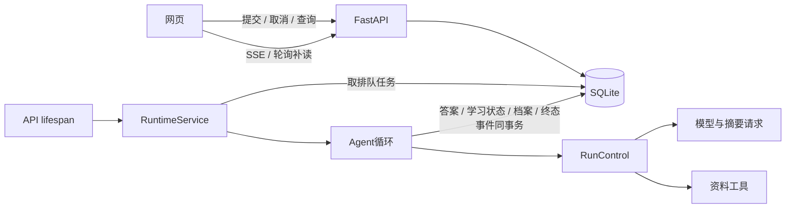

# 问答执行与交互（RT1）

更新于：2026-10-20 09:53（Asia/Shanghai，UTC+08:00）。

RT1已实现持久提交、后台执行、进度订阅、刷新恢复、取消和事务交付。执行器仍驱动现有Agent循环：模型根据观察选择工具，再继续讲解；调度层负责执行的生命周期，不替代模型的行动选择。

## 使用流程

在网页发送问题后，问题与任务一起保存，接口立即返回任务ID。任务卡显示排队、模型请求、工具开始/返回和完成等实际事件。讲解正文经过原有校验后一次展示，当前不是正文逐字流式。

刷新或关闭网页不取消任务。重新打开该会话，网页查询最新任务并补读事件；SSE连接失败时改为查询状态和事件。状态以SQLite记录为准，浏览器连接断开不等于问答失败。用户可以切换会话，其他会话的问题进入同一队列。

“停止本轮”提交取消请求。等待模型请求退出或已开始的同步工具结束后，显示停止状态，允许重新提问。已发出的远端请求可能仍执行并计费；本地取消不能保证撤销费用。

API进程退出后不会继续执行。重新启动API时：

- 未开始的排队任务可继续；若模型配置或学习状态版本改变，则中断并等待用户处理。
- 正在执行的任务标为“已中断”，不自动重发模型请求。点击“结束此轮，重新提问”释放会话。
- 已完成或已取消的结果继续保留。

RT1恢复的是任务发现与交互入口。中间步骤续跑属于RT2，当前没有`resume`接口；页面不会显示不可用的继续按钮。

## 执行结构

一个API进程执行一个问答，默认最多排队20个，可用`LA_RUNTIME_QUEUE_LIMIT`调整。队列满返回503，不保存半条用户消息。同会话的`queued/running/cancelling/interrupted`均占用问答位置，阻止另一个问题及相关学习状态/记忆修改；中断任务不占执行线程。

`.runtime.lock`独占锁防止同一数据目录启动两个调度器。保持`--workers 1`；多会话排队不代表多进程或多用户部署。媒体worker仍只负责回放、ASR和索引，无需增加问答worker启动命令。

## 持久边界

| 记录 | 用途与当前边界 |
| --- | --- |
| `runs` | 身份、状态、所有者、修订和取消标记；查询不暴露内部所有者 |
| `run_inputs` | 固定问题、选中位置、反馈目标、学习状态和选入记忆；模型配置保存无密钥的标识 |
| `run_events` | 每个任务单调递增seq，供SSE和查询补读；只发布进度、工具名和位置等摘要，不发布思维链 |
| `run_operations` | 主模型与摘要的prepared/sending/returned记录；中断时sending变unknown，不据此自动重发 |
| `run_checkpoints` | 当前远端操作边界指针，明确标记不可续跑；尚不是完整Agent执行状态 |
| 原有协议档案和上下文快照 | 保存已观察到的资料、输入选择及诊断；取消/失败档案不自动重放 |

同一个`client_request_id`和相同内容返回已有任务，不重复插入消息或调用模型；同ID不同内容返回409。网页在确认收到任务ID前保留提交草稿，网络异常后可明确重试确认。调用方重试同一次提交时必须复用ID，新问题使用新ID。

交付事务检查所有权、取消标记与学习状态修订。答案消息、可重放档案、有效学习更新和终态事件一并提交；状态CAS影响行数必须为1。完成先提交，则后来的取消不改写答案；取消先提交，则不能发布成功答案或学习更新。重复交付返回原结果。

取消或失败任务的系统提示与正式讲解分开标记，不提供理解反馈按钮。摘要写入也检查运行所有权和取消状态，已取消摘要不能成为ready。遗忘记忆会清除新增`run_inputs`中的注入记忆副本；原始问题、模型输出和工具观察仍遵守[既有保留边界](learning-memory.md)。

## 接口

| 接口 | 行为 |
| --- | --- |
| `POST /api/conversations/{id}/runs` | JSON包含content、必需的client_request_id及可选focus/feedback，返回202与任务ID、查询及事件地址 |
| `GET /api/conversations/{id}/runs` | status=active/all、limit=1..50、before=返回记录的cursor；按创建顺序倒序 |
| `GET /api/runs/{id}` | 状态、最后事件seq、正式答案/系统结果、可用动作，以及原有工具轨迹和上下文诊断 |
| `GET /api/runs/{id}/events?after=0` | 默认返回JSON事件列表，最多100条，可继续补读 |
| 同一事件接口，Accept: text/event-stream | SSE事件名为progress，data中的type说明业务事件；id为持久seq，Last-Event-ID优先于after |
| `POST /api/runs/{id}/cancel` | 排队/中断任务立即结束；执行中的任务进入cancelling；重复取消保持原状态 |
| `POST /api/conversations/{id}/messages` | 旧同步兼容：提交到相同Runtime并等待结果；可用Idempotency-Key去重，断开只停止等待 |

非法或超前事件游标返回422。SSE定期发送注释心跳，终态和中断事件补读完后关闭连接。查不存在任务返回404；状态冲突409；未启动调度器、队列满或缺少模型配置时返回503。已存在的幂等提交可在密钥未配置时确认，不因此创建新调用。

Python嵌入使用需要显式进入FastAPI lifespan，例如`with TestClient(create_app(settings)) as client:`。不启动lifespan时不会偷偷创建临时执行器。

## 验证与限制

- 工程回归107项通过，其中12项新增Runtime测试，覆盖幂等、队列上限、请求等待方断开、取消、事务竞争、摘要取消、配置版本、记忆遗忘、单调度器和真实子进程SIGKILL重启。子进程故障测试使用可控模型，不冒充真实模型恢复实验。
- 配置的`gpt-6.1-sol`兼容Chat Completions网关两轮真实验收完成。提交约9/12 ms，完整交付约6.4/8.1秒；每轮一个主模型操作，重复提交不增加调用，SSE终态补读成功。样本很小，不是性能基准或教学收益评估。可用`uv run python examples/evaluate_runtime.py --real`复现；结果写入被忽略的data目录。
- 浏览器使用隔离的可控模型，验证提交后任务卡、刷新期间继续执行、完成后自动展示讲解、进度订阅断开后查询降级、取消，以及提交已保存但响应丢失后的同ID确认（3个任务、3次模型操作，没有重复消息）。该验收验证交互，不用于证明模型讲解效果。

RT2仍需完整循环游标和工具批次恢复、embedding远端调用边界、图片/抽帧产物原子发布，以及可终止渲染子进程。RT1中的同步工具使用线程，取消会等待它结束；不承诺强制立即停止或崩溃后缓存完全无半文件。RT3再处理正文流式、两种协议的分块适配及更完整课程验收。完整后续方案见[模块设计](agent-runtime-design.md)。
