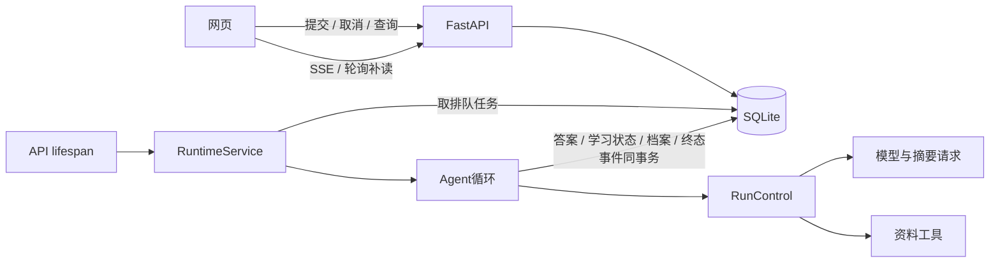

# 问答执行、交互与恢复（RT1 / RT2）

更新于：2026-10-20 11:46（Asia/Shanghai，UTC+08:00）。

RT1已实现持久提交、后台执行、进度订阅、刷新恢复、取消和事务交付；RT2补齐执行检查点、恢复与明确重试、远端操作边界和受控图像产物。执行器仍驱动现有Agent循环：模型根据观察选择工具，再继续讲解；调度层负责执行的生命周期，不替代模型的行动选择。

## 使用流程

在网页发送问题后，问题与任务一起保存，接口立即返回任务ID。任务卡显示排队、模型请求、工具开始/返回和完成等实际事件。讲解正文经过原有校验后一次展示，当前不是正文逐字流式。

刷新或关闭网页不取消任务。重新打开该会话，网页查询最新任务并补读事件；SSE连接失败时改为查询状态和事件。状态以SQLite记录为准，浏览器连接断开不等于问答失败。用户可以切换会话，其他会话的问题进入同一队列。

“停止本轮”提交取消请求。等待模型请求退出或已开始的同步工具结束后，显示停止状态，允许重新提问。已发出的远端请求可能仍执行并计费；本地取消不能保证撤销费用。

API进程退出后不会继续执行。重新启动API时：

- 未开始的排队任务可继续；若模型配置或学习状态版本改变，则中断并等待用户处理。
- 执行中任务按检查点和操作记录恢复：已返回的模型结果、已完成工具及待提交答案直接复用；本地工具未完成时可在版本和预算允许下重做。
- 主模型请求结果未知时等待用户勾选可能再次计费的确认，再点击“确认后重试模型请求”，也可结束本轮。摘要与查询向量结果未知时不补发，分别沿用裁减和BM25。
- 已完成或已取消的结果继续保留。

旧RT1任务没有完整执行状态时仍不能中途续跑，提供结束入口；迁移不虚构检查点，也不调用模型。RT2任务保留同一个运行ID、用户问题和反馈，恢复不重置预算。

## 执行结构



一个API进程执行一个问答，默认最多排队20个，可用`LA_RUNTIME_QUEUE_LIMIT`调整。队列满返回503，不保存半条用户消息。同会话的`queued/running/cancelling/interrupted`均占用问答位置，阻止另一个问题及相关学习状态/记忆修改；中断任务不占执行线程。

`.runtime.lock`独占锁防止同一数据目录启动两个调度器。保持`--workers 1`；多会话排队不代表多进程或多用户部署。媒体worker仍只负责回放、ASR和索引，无需增加问答worker启动命令。

## 持久边界

| 记录 | 用途与当前边界 |
| --- | --- |
| `runs` | 身份、状态、所有者、修订和取消标记；查询不暴露内部所有者 |
| `run_inputs` | 固定问题、位置、反馈目标、学习状态、接续设置、记忆及模型/执行策略；不保存密钥 |
| `run_events` | 每个任务单调递增seq，供SSE和查询补读；只发布进度、工具名和位置等摘要，不发布思维链 |
| `run_operations` | 主模型、摘要、查询向量与工具的逻辑位置和尝试；保存prepared/sending/returned/unknown/failed/returned_invalid、结果、usage状态、时间及图像预留 |
| `run_checkpoints` | schema v2与修订、prepare/model/tools/ready_to_commit阶段、协议组、批次游标、观察缓存、计数、摘要与待提交状态；与操作记录一起决定下一步 |
| `run_actions` | 恢复操作ID、期望修订和确认参数；操作响应丢失时可以同ID确认 |
| 原有协议档案和上下文快照 | 保存已观察到的资料、输入选择及诊断；取消/失败档案不自动重放 |

同一个`client_request_id`和相同内容返回已有任务，不重复插入消息或调用模型；同ID不同内容返回409。网页在确认收到任务ID前保留提交草稿，网络异常后可明确重试确认。调用方重试同一次提交时必须复用ID，新问题使用新ID。

交付事务检查所有权、取消标记与学习状态修订。答案消息、可重放档案、有效学习更新和终态事件一并提交；状态CAS影响行数必须为1。完成先提交，则后来的取消不改写答案；取消先提交，则不能发布成功答案或学习更新。重复交付返回原结果。

取消或失败任务的系统提示与正式讲解分开标记，不提供理解反馈按钮。摘要写入也检查运行所有权和取消状态，已取消摘要不能成为ready。遗忘记忆会清除`run_inputs`中的注入记忆副本，并删除受影响已结束任务的派生执行检查点；原始问题、模型输出和工具观察仍遵守[既有保留边界](learning-memory.md)。

## 接口

| 接口 | 行为 |
| --- | --- |
| `POST /api/conversations/{id}/runs` | JSON包含content、必需的client_request_id及可选focus/feedback，返回202与任务ID、查询及事件地址 |
| `GET /api/conversations/{id}/runs` | status=active/all、limit=1..50、before=返回记录的cursor；按创建顺序倒序 |
| `GET /api/runs/{id}` | 状态、最后事件seq、正式答案/系统结果、可用动作，以及原有工具轨迹和上下文诊断 |
| `GET /api/runs/{id}/events?after=0` | 默认返回JSON事件列表，最多100条，可继续补读 |
| 同一事件接口，Accept: text/event-stream | SSE事件名为progress，data中的type说明业务事件；id为持久seq，Last-Event-ID优先于after |
| `POST /api/runs/{id}/resume` | JSON包含action_id、expected_revision与acknowledge_unknown_request；同操作ID同参数幂等，过期修订或缺少未知费用确认返回409 |
| `POST /api/runs/{id}/cancel` | 排队/中断任务立即结束；执行中的任务进入cancelling；重复取消保持原状态 |
| `POST /api/conversations/{id}/messages` | 旧同步兼容：提交到相同Runtime并等待结果；可用Idempotency-Key去重，断开只停止等待 |

非法或超前事件游标返回422。SSE定期发送注释心跳，终态和中断事件补读完后关闭连接。查不存在任务返回404；状态冲突409；未启动调度器、队列满或缺少模型配置时返回503。已存在的幂等提交可在密钥未配置时确认，不因此创建新调用。

Python嵌入使用需要显式进入FastAPI lifespan，例如`with TestClient(create_app(settings)) as client:`。不启动lifespan时不会偷偷创建临时执行器。

## RT2的恢复规则

恢复同时检查冻结的模型/协议、上下文和执行策略、学习状态与接续设置，以及已查阅资料的修订。全空间目录/搜索观察还检查语料范围。步骤开始、工具返回、下次模型调用和最终交付再次验证；最终事务内也会核对资料版本和检查点修订，不能用过期观察发布答案。完整模型返回和usage先保存，循环只在所有工具结果配对后发送下次模型请求。Responses原生项目保留在内部状态，不进入公开进度。

每轮最多3次恢复入队/明确重试；主模型新尝试受原max_steps限制，工具实际新尝试合计最多12次，图片额度使用原配置。图像在工具开始前持久预留，未知尝试不返还；成功错误观察可释放未使用的预留。复用已完成结果不重复扣除，缺图重建和显式重新附加使用额度。

执行时间默认总预算为2×LA_TIMEOUT_SECONDS。每个外部操作先持久预留不超过剩余量的超时，已知完成后返还未使用部分；崩溃或结果未知时不返还。查询向量耗时包含在所属工具中，不重复计时。排队和等待用户不扣预算。轨迹的elapsed_basis=operation_accounting表示累计保守操作账目，包含未知尝试的预留，不是排队墙钟时间或实际账单时间。usage缺失明确为unknown/unavailable，不补记零费用。

PDF和视频画面工具使用按需启动的子进程；其FFmpeg共享所属进程组，取消会结束这一组。父进程被强杀时，管道关闭触发子进程退出。每次尝试写独立临时目录，执行器核对所有权、版本和PNG后原子发布。孤立临时产物不会作为缓存采用；缓存损坏可重建，恢复缺图要有可核对的原位置及剩余工具/图像预算。普通短数据库读取仍在线程执行，取消会等待它退出；问答恢复不重开媒体worker的ASR或索引任务。

版本改变、预算不足或恢复次数用尽时，不继续旧执行。用户可以结束此轮，再以新问题和新上下文开始。远端网关与SQLite之间没有原子事务：sending既可能尚未实际发出，也可能已经计费但响应没有落库；系统不承诺云端请求恰好执行一次。

## 验证与限制

- 全量127项测试通过，其中20项RT2专项覆盖真正的子进程强杀与重启：prepared、完整响应、部分工具批次、ready答案、未知主请求的明确且幂等重试、摘要/向量结果复用或降级、Responses原生项目、资料版本竞态、预算和恢复上限、缺图重建、渲染取消及父进程退出后的子进程清理。可控模型验证工程语义，不是云端效果评估。
- 真实兼容Chat Completions网关使用gpt-6.1-sol和既有CS231n课程optimization.pdf第14页：首个模型响应落库后SIGKILL，重启接着执行inspect_page及最终讲解；两次主模型请求各一个attempt，没有重发首个请求，总墙钟约13.4秒，学习状态更新一次。核对实际图像与回答的5个数据点、复杂曲线/简单直线及正则化含义相符。单例不构成大规模教学或性能基准，Responses仍只有离线验证。
- RT1既有两轮真实调用与刷新、断线降级、取消、提交响应丢失验收继续保留。RT2网页用受控模型核对未知结果提示、确认前按钮禁用、明确重试、同一任务交付，以及消息快照早于终态时自动补读答案。

真实恢复验收会产生费用，输出须使用新目录：

```bash
uv run python examples/evaluate_recovery.py --real \
  --pdf data/acceptance/optimization.pdf --page 14
```

资料自行提供；测试不自动下载课程，不自动重试未知模型请求。原资料和报告在被忽略的data目录，密钥不进入报告。

RT3尚未实现正文流式、分块JSON/公式适配及更完整的课程交互验收。当前仍是本机单用户、单API进程，无多租户授权或分布式接管；操作系统文件锁只支持已有macOS/Linux边界。完整规划见[模块设计](agent-runtime-design.md)。
