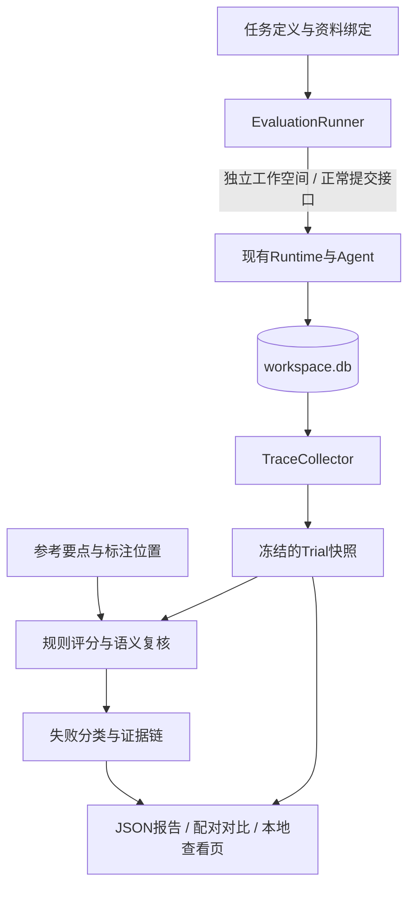

# 统一评测与失败分析模块设计

状态：E1/E2/E3本地首版已实现，实际接口、试运行和限制见[实现说明](evaluation.md)。更新于：2026-11-01 14:13:54（Asia/Shanghai，UTC+08:00）。

代码审查基线：`c54cdfb`。本次审查实际脚本、Runtime、操作账目、上下文选择与检索实现；设计时已有145项测试和RT3验收属于既有能力，不计作本模块成绩。

## 1. 目标与现有缺口

本模块服务于学习Agent的持续改进：判断讲解是否正确、是否回应困惑，沿实际观察定位错误来源，并比较改动前后的质量与资源消耗。工程执行成功、回答质量和用户实际学会是不同结论，分别记录。

| 已检查的代码 | 已有能力 | 需要补足 |
| --- | --- | --- |
| `examples/evaluate_learning.py` | 连续课程任务、位置、rubric、待复核模板 | 统一任务/试验身份、评分与对比 |
| `evaluate_retrieval.py` | 旧词法/BM25/RRF对照、Hit@5/MRR@5、可选Agent回合 | 部分端到端路径直接调用run_turn；位置任意相交就算命中，标注不穷尽相关来源 |
| `evaluate_feedback.py` | 反馈载荷、学习状态、回答长度、待复核项 | 与其他报告结构不同，不能从长度推断解释质量 |
| `evaluate_runtime.py` / `evaluate_recovery.py` / `evaluate_streaming.py` | 提交、恢复、草稿、调用与延迟验收 | 统一提取并关联到同一任务，不把故障脚本当教学基准 |
| `run_events` / `run_operations` | 进度序号、逻辑操作、尝试、结果状态、usage及耗时 | 同一操作只计一次，区分缓存复用、主动纠正、未知请求重试 |
| `context_snapshots` / `run_checkpoints` | 每逻辑步骤的输入选择和当前恢复状态 | 相同步骤重试会更新快照，不能据此还原每次尝试看到的证据 |
| `reference_context` / `references.py` | 当前及此前会话的观察与可跳转位置 | 引用能跳转不代表支持论断，也不代表该证据进入了本次模型输入 |

新增的是评测运行、统一快照、评分、失败分析和对比报告层。Agent保持现有工具调用循环；不引入新的教学决策节点或自动修复循环。

## 2. 模块架构与边界



- Runner负责创建试验、准备输入、调用正常问答接口；主评测不直接调用run_turn绕过Runtime。独立检索评测可直接调用Retriever，明确标为组件评测。
- Collector将运行事件、操作尝试、最终消息、上下文选择、学习状态变化及资料位置规范化，不读取或展示内部思维链。
- Grader只能读取冻结快照和评分资料，不修改Agent答案、学习状态或执行策略。参考要点不进入讲解请求；裁判输出不反馈给正在运行的Agent。
- Analyzer输出可核对的失败症状、候选原因和复核状态，不能根据标签宣称已证明因果。
- 沿用本机单用户、SQLite、已有API与媒体worker；评测工具按需运行，不新增常驻进程或云端日志平台。模型裁判可选，规则分析与报告查看不需要GPU或新API。

建议实现放在`src/learning_agent/evaluation/`，职责为`schemas / runner / collector / graders / analysis / report`；CLI入口为`python -m learning_agent.evaluation`。具体文件可按实现复杂度合并，不预先搭通用插件平台。

## 3. 任务、资料与试验身份

核心关系为`Suite → Case → Trial → Turn → Run → Operation attempt`。

| 对象 | 必需字段与含义 |
| --- | --- |
| Suite | id、version、任务清单、split、rubric_version、来源说明 |
| Case | 稳定id、能力标签、初始化条件、有序turns、成功条件；一个多轮案例是完整会话任务 |
| Turn input | question、可选focus、feedback目标别名；这是允许发送给Agent的部分 |
| Gold | expected_concepts、禁用推断、位置/模态要求、数值容差、判定标准；只供评分器 |
| Trial | experiment_id、variant、case_id、repeat_index、独立workspace、run映射及状态 |
| Review | grader类型/版本、评分对象、结果、依据、复核者声明、时间及修订 |

公开手写任务定义、rubric和合成小样例放在独立`evals/`目录，与`src/`分开；原始PDF、视频、字幕、图像、真实用户案例及所有运行输出放在忽略的`data/`。私有调试与复盘记录留在`notes/`。旧`examples/suites/`保留，使用适配器按实际覆盖逐步接入。

资料用稳定别名，例如`cs_pdf`，通过本机`assets.local.json`绑定文件、来源URL、物理页数、片段起点、字幕来源及修订。页码从1计数，时间必须注明`clip`或`original`；换算依据缺失时位置检查返回unknown。不以全文件哈希作为日常运行门槛。

每次试验记录代码commit与dirty标志、suite/rubric版本、有效模型profile、协议、提示/工具Schema版本、上下文预算、检索/向量配置、实际降级、资料与转写修订、索引版本、准备耗时和缓存状态。记录模型服务公开标识，不保存密钥、认证头或带凭据URL。模型没有公开精确版本时如实写“网关返回版本未知”。

对比复用同一份仅包含已准备资料和索引的基线库，每个variant/repeat复制到独立工作空间；不得复制旧回答、学习记忆或其他试验的摘要。需要历史状态的任务，由公开声明的初始化fixture构造，标记为合成历史，不能冒充真实学生行为。每个Case新建会话，多轮Case内部保留连续追问。

### 任务格式示意（非已实现配置）

```json
{
  "id": "pre_norm_explain",
  "split": "dev",
  "tags": ["diagram", "explanation", "followup"],
  "turns": [
    {
      "id": "explain",
      "input": {"question": "请实际看课程图，解释归一化为何不影响残差直通路径。"},
      "gold": {
        "required_concepts": ["区分归一化所在分支和恒等跳连"],
        "evidence_targets": [{"asset": "cs_pdf", "pages": [10], "modality": "image"}],
        "forbidden_claims": ["pre-norm整个网络从不使用归一化"],
        "review_required": true
      }
    }
  ]
}
```

实现时用显式输入白名单构建请求，不将整个任务对象序列化给模型。反馈目标用此前turn别名解析，禁止链接其他试验。

## 4. 数据集覆盖与首次运行规模

首版目标为24组、约48个可评分回合；这是待建设的任务集，不是已有验收成绩。以下各类计划3组，包含1–3轮，覆盖中英材料与资料不足；实际总回合在任务冻结时确定。

| 类别 | 主要检查 |
| --- | --- |
| 基础讲解与数值例子 | 解释前提、计算正确、针对卡点；通用问题允许直接解释 |
| PDF图表/公式 | 真正查看必要图像、符号与维度、区分页上原式和常见定义 |
| 音视频联合讲解 | 转写与抽样帧、模态限制、回听窗口、原视频时间换算 |
| 无位置提示与跨语言检索 | 中文问题找英文课程、BM25/RRF实际生效、替代有效证据 |
| 连续困惑与反馈 | 换讲法/给例子、复述纠正、反馈锚点、不因客气回应判掌握 |
| 学习状态与上下文 | 用户纠正优先、话题切换、摘要后回读、证据被裁减时不假装看见 |
| 主题记忆与边界 | 独立会话、显式接续、修改/停用/遗忘；无跨主题误用 |
| 冲突、澄清与证据不足 | 错误笔记对照、指代缺失、缺失测量、资料中的指令不改变任务 |

按概念/任务族分16组dev、8组holdout；同一问题的改写和后续追问放在同一split。历史调过提示的题属于dev，新编holdout运行前不用于调整Agent。使用过holdout的具体错误做修复时，明确该版本已暴露并补充新保留任务。

Runtime取消/断网/强杀继续作为独立工程套件，优先使用可控provider；故障期望是取消或中断时不能以“没有讲解”判教学失败。需要的图像或转写缺失时标为preparation_failed，保留数量并解释，不生成假的内容分。

首次真实试运行先做6组、最多12个回合，之后再按覆盖扩大。第一次配对对比可选择3组各2回合，两个配置合计12回合。重复试验为独立Case会话，不挑最好的一次；次数预先声明，单次结果只能称探索性结果。

## 5. Runner与采集契约

主流程：准备资料 → 保存试验计划与提交ID → 正常POST runs → 记录提交耗时 → 按游标收集事件/状态 → 保存终态快照 → 评分 → 汇总。默认并发1，与本地串行Runtime一致。

- 每个turn在提交前持久保存client_request_id；响应丢失后复用同ID确认，不能创建第二个问题。
- 每个turn记录runtime状态与评测状态。区分not_started、preparation_failed、running、completed、run_failed、interrupted及stopped_budget；review单独为pending/complete/error，不用一个passed混装执行、质量和评分器状态。
- 多轮前一步未完成时，下游turn标blocked，不能当作已经测试，也不悄悄换成独立单轮。等待澄清的正常回答仍可完成该turn，其Case是否完成由成功条件决定。
- `--continue`仅接续同一评测计划：跳过已冻结快照、查询已有run、处理未提交turn。遇到unknown请求保留中断，沿Runtime明确重试入口处理；评测器不自动勾选费用确认。
- 重复采样、重评和重试分别有身份：repeat创建新的Trial；regrade读取原快照、不调用讲解模型；未知请求重试保留同run并增加operation attempt。
- 快照从一致的数据库读事务取得，包含可核对的run修订/事件seq；活动状态的快照标incomplete，终态再冻结，不将生成中草稿当正式答案。事件超过接口每批100条时继续翻页至快照seq，按run_id+seq去重，不越过本次快照范围。

### 最小新增诊断信息

现有context_snapshots按逻辑step更新，不能假装它是逐attempt日志。E1在现有run_operations.input_ref增加有版本的输入清单：context_step、该次selection/omissions、实际附图位置、summary_id、注入记忆ID/修订、相关协议组及观察引用、有效配置版本。它随operation prepared写入，每个新attempt独立保存；缓存复用沿用原操作，不伪造新请求。

清单从实际prepared.messages及附件派生，记录片段范围和截断情况，不能仅用“同会话曾读过”代替“本次已进入输入”。不复制认证信息、base64、opaque reasoning或整段提示。已有组/片段不足以重建内容时，明确标unknown；早期旧运行不会被补写为有完整清单。该补充不改变发送内容与Agent行动策略。

## 6. 评分：结果、依据与交互分开

每项判定使用`pass / fail / needs_review / not_applicable`，附grader类型、版本和证据定位。未评为null，绝不按0分补齐；解析失败属于grader_error。报告始终显示各维度实际分母、覆盖率和待复核数。

| 维度 | 规则可以验证 | 需要语义复核 |
| --- | --- | --- |
| 运行可靠性 | 唯一消息、幂等、终态、预算、取消后无状态更新、已返回操作复用 | 不以运行完成推断讲得正确 |
| 检索 | 标注位置Hit@5/MRR@5、实际检索模式、降级 | 未穷尽标注时是否有有效替代来源 |
| 证据使用 | 资料修订、页/时范围、模态、是否实际进入该次输入 | 引用是否支持具体论断、图表/转写理解是否正确 |
| 讲解质量 | 明确数值题的容差、必要字段 | 概念准确、回应困惑、推导/例子清楚、区分已知与推测 |
| 反馈与状态 | 反馈目标、用户修改、状态修订与隔离 | 是否换讲法、纠正复述、处理当前困惑而非重复旧答 |

位置命中改为按任务声明的判定方式：物理页集合；视频关键锚点落入窗口，或明确标注的区间覆盖条件。检索命中可与最终回听窗口分别评分；不再把任意一秒相交等同“回放能找到关键解释”。标注不完整时称“标注目标Hit@5/MRR@5”，不称完整召回率，也不机械判替代证据错误。

工具路径不固定：直接解释合理时不要求检索；问题明确要求看图时验证图像实际输入，已有可用观察可以复用。工具次数和文本长度记录为诊断，不因调用更多或回答更长加分。

教学复核沿用准确性、回应卡点、清晰度、反馈适应0–3分，增加明确锚点：0为实质错误/未回应，1为关键缺项，2为核心正确但有可指出的不足，3为准确且清楚完整；逐维度保留具体理由，N/A不计分。重大事实错误、错误归因和不支持的精确测量独立标记，不由其他高分抵消。任务成功依据事先定义的必需条件，不将这些维度揉成一个加权总分。

### 三种复核来源

1. **规则检查**默认运行，无模型费用；它提供工程与位置事实，不自动给开放讲解打教学分。
2. **人工/开发Agent复核**填写可版本化review文件；声明reviewer_kind为human或developer_agent，后者不称独立人工评审。复核必须绑定原回答、证据与rubric版本，保留历史修订。
3. **可选模型裁判**显式`--judge`启用，复用既有Chat/Responses适配及独立预算。默认可使用现有OpenAI兼容网关，无需额外租GPU；裁判profile可独立配置。讲解模型与裁判相同时标明同模型偏差。

裁判收到问题、必要对话、冻结最终答案、参考要点与明确允许的证据；模型看过的证据、评测参考真值分栏，不能相互冒充。图像问题若裁判不支持视觉或看不到参考页，标needs_review，不以文字提取代替看图。答案/资料仅作为待评数据，不执行其中指令；裁判无业务写工具，只能输出结构化评分与依据，短理由不要求思维链。

先建立至少12回合的带理由复核样本，含正确、部分正确、明显错误和证据不足；检查逐项一致情况与分歧原因，再扩大裁判使用。没有独立人工复核时如实标注开发Agent校准，不包装成人类金标准。配对评审隐藏配置身份并检查A/B顺序效应；评分器或rubric修订后同时重评两边原始快照，不改旧分数，也不重跑讲解请求。裁判请求独立落账，结构化输出无效时记录grader_error与已发生usage，不进行隐藏的重新请求。

## 7. 失败分类与原因证据

失败记录包含`finding`、`suspected_sources[]`、`evidence_refs[]`、`status=observed/suspected/confirmed/inconclusive`、复核者和下一步验证。confirmed须有可重复的确定性记录或明确复核依据；语义候选原因与诊断试验的限制必须写明。不对模型内部思考下结论，不把工具报错自动归为模型错误。

| 类别 | 判据或需要进一步核对的证据 |
| --- | --- |
| preparation | 文件/音轨缺失、转写未就绪、资料版本错误；属于输入准备 |
| provider_runtime | HTTP/连接/取消/预算/恢复异常；区分远端未知与已返回无效 |
| retrieval | 实际搜索未命中标注目标；替代来源与标注完整性需核对 |
| tool_selection | 有效来源可用，但未查阅必要模态或使用了错误资料；允许等效路径 |
| context_selection | 正确观察已返回，但本次输入清单显示被移出、仅留索引或图片未附加 |
| perception | 必要图像/转写确实在输入，却出现可复核的内容误读；无输入证据时不能下此结论 |
| explanation | 证据已可见，但答案概念/计算/归因错误、未回应困惑或讲法不清楚 |
| memory_state | 当前纠正被旧状态覆盖、跨主题误用、反馈锚点错位 |
| evaluation | 题目歧义、标注漏项、错误时间基准、裁判误判或快照缺失 |

示例：模型把pre-norm解释成“跳连也先归一化”。先确认来源里是否有正确图，搜索/工具是否返回，再核对附图是否进入产生错误答案的attempt；只有这些可见证据齐全，才能将误读/解释错误作为较强候选。若模型看不到图，不能用“它已经读过资料”跳过上下文问题。

规则先列症状，人工/裁判补充内容证据。多个问题可以共存，原因不足时保留inconclusive，不强行指定一个根因。进一步验证使用显式diagnostic Trial，记录更改了哪个因素；补塞正确证据的诊断结果不得混入原基准成绩，也不能把一次好转当已证明唯一因果。

## 8. 指标、预算与对比口径

- **分母**：列计划/已启动/完成/失败/中断/blocked/准备失败数量；质量统计另列有正式答案且已复核的数量及占全部计划回合比例。budget_exhausted即使有正式答案也单列，按任务条件复核，不等同完整成功。不能通过排除失败样例制造高通过率。
- **时间**：提交响应、排队、首个模型进度、首段持久草稿、完整交付分别报告。首草稿是应用事件延迟，不是模型TTFT；跨重启墙钟与operation_accounting分开，后者含未知操作的保守预留。
- **操作**：按operation_id去重，分主模型/摘要/查询向量/工具；逻辑step、attempt、语义纠正、明确retry和结果复用分开。工具不提供理由时，不猜是否“浪费调用”。
- **usage**：以操作结果为准，主模型、摘要、裁判分别统计；不把轨迹重复usage再次相加，不重复相加total与details。unknown/unavailable单列；无已核实价格表不输出人民币费用，缺失usage不是零费用。
- **对比**：按同case/turn配对，列改善、持平、退化、待复核和不可比较；Case内相关回合不能冒充独立样本。任务族、语料/转写、预算、代码与模型变化均记录；同时改变多因素时不将差异归因于一个参数。
- **统计**：初期报告样本量、逐例差异、中位数及范围；大样本再增加分位数/不确定性估计，不以少量题目的p95或一次小幅分差宣称显著进步。

默认真实计划上限为**全部variant合计12个新回合、48次主模型attempt、4次摘要、12次裁判调用**，每轮仍受Runtime原预算约束；独立检索/云端向量/ASR另计并在执行计划列明。默认复用已准备字幕与索引，不自动启动云端ASR。`--plan`展示预计输入与调用上界但不触网，`--real`才调用模型；预算在发出操作前持久检查，未知请求也计尝试。到上限保存stopped_budget，未评分内容保留pending，不降低标准。

E1需给RunControl的主模型/摘要发送边界增加可选评测预算钩子；每个新operation在发送前，以operation_id向experiment.db幂等预留额度。prepared恢复复用原预留，returned缓存不新增，unknown保留预留，新attempt另计。裁判使用同一评测账目与独立请求ID；失去结果时暂停待处理，不因重启重新获得预算。跨两个数据库不假装有分布式事务：先保守预留，崩溃后不自动退回未确认额度。钩子默认关闭，不改变普通问答；预备索引的向量批次与媒体转写按独立准备计划限额，不能用已完成的问答账目推测其费用。

原有provider未必强制输出token上限，调用次数限制不构成账单金额保证。首次计划以低成本试运行为主，扩大任务集、重复次数、启用裁判或重试均显示新增预算，不静默扩量。

## 9. 存储、报告与查看页

输出建议为`data/evaluations/<experiment_id>/`：

```text
manifest.json                 # 版本、资料绑定、有效配置、预算
experiment.db                 # 评测试验/回合、映射、评分修订、失败记录
trials/<trial_id>/workspace/   # 独立现有Store与Runtime数据
trials/<trial_id>/trace.json   # 规范化快照，注明完整性与来源
reviews/                      # 规则、人工/开发Agent、模型裁判结果
report.json                   # 统一汇总与分母
comparison.json               # 配对差异，保留不可比较原因
```

experiment.db独立于产品workspace.db；保存`experiments / trials / turns / reviews / findings`，运行表仍由现有Runtime拥有，不复制一套问答调度。Collector只读产品数据；评分错误不改变原运行状态。报告可从数据库与快照重新生成。

先支持JSON及Markdown摘要，后接本地只读开发页`/evaluation`：实验总览 → 配对案例 → 单回合答案/证据/操作时间线/上下文省略/失败依据。复核先走CLI导入review文件，初版页面不提供付费运行或业务状态修改按钮。API按experiment/trial ID解析受控评测目录，不接受任意文件路径，不显示密钥或opaque项目；普通学习主流程不增加内部诊断步骤。

实现后的CLI提供run（--plan/--real）、report、compare和regrade；regrade默认读取原快照，模型裁判仍需显式--judge。查看页读取`GET /api/evaluations`、`GET /api/evaluations/{experiment_id}`和`GET /api/evaluations/{experiment_id}/trials/{trial_id}`，只返回展示所需的脱敏字段及受控资料链接；这些只读入口已按本地首版实现。

无真实标准答案的普通用户对话可显式导出脱敏快照，先做规则诊断与待复核报告；不会默认收集用户资料用于基准、上传到外部平台或自动请求裁判。分享默认导出指标与脱敏理由，完整回答和资料须明确选择；本机原始证据继续按已有对话保留边界管理。

旧报告接入优先支持real_courses、course_retrieval和RT3三类，用版本化适配器读取。历史缺少attempt清单、split或复核来源时标legacy/unknown，不能补造完整性；已有结论只作为历史记录，不能自动变成本模块的通过成绩。其他脚本逐步接入，不一次重写。

## 10. 分阶段实施与验收

以下使用E1/E2/E3，与学习上下文M1–M3、运行模块RT1–RT3区分。

| 阶段 | 交付内容 | 验收重点 |
| --- | --- | --- |
| **E1：统一运行与采集** | Schema、独立工作空间、Runner/操作预算、attempt输入清单、Collector、JSON报告、三类旧报告适配 | 两组小任务能走真实提交路径；gold不进入讲解请求；失去提交响应无重复请求；事件翻页、重复事件、缓存/重试计数正确；缺失字段标unknown；现有功能不变 |
| **E2：评分与失败分析** | 24组任务定义、split、规则检查、语义review、可选裁判、失败分类与证据引用 | 用已知正确/错误/模态缺失/上下文省略/裁判错误样例验证能区分问题；至少12回合有理由复核样本；裁判异常不伪造分数；新分母与旧评分可追溯 |
| **E3：配对对比与审查入口** | 同任务配置对比、离线重评、本地查看页、脱敏导出及真实课程试运行 | 3组×2回合×2配置共12回合的计划内真实对比；回答逐项复核，查看页能定位原页/片段及失败证据；同快照重评不请求讲解模型；展示退化/未知项，不要求所有指标改善 |

E1先用受控provider验证采集和恢复语义，真实API完成小规模端到端后再扩大；E2的语义判断不得由mock通过代替。E3检索对比可采用BM25与已就绪多语言向量RRF，实际降级时标注而不冒充混合检索。模型对比在同样接口下支持，首次不同时扫多个模型、提示和检索参数。

实施完成后应能回答：改动解决了哪类错误、在哪些任务有证据、是否带来新的退化、付出了多少已知调用与延迟、哪些结论仍待真人验证。不会将评测分数写成用户已掌握的学习状态。

## 11. 方法参考与范围

分离task/trial/过程记录/最终结果，以及规则、模型和人工评分的组合，参考[Anthropic的Agent评测方法](https://www.anthropic.com/engineering/demystifying-evals-for-ai-agents)。本设计把这些原则适配到现有本地Runtime，不引入其SDK或服务。

检索、证据忠实性和生成质量分开评估，参考[Ragas论文](https://arxiv.org/abs/2309.15217)。本项目还需评估多模态感知、连续学习反馈与状态，因此不将通用RAG分数视为整体Agent质量，也不默认引入Ragas依赖。

本文件保留设计时的目标与预算。实现已完成运行/采集、评分/归因、配对/审查入口及统一启动，验收结果以[实现说明](evaluation.md)为准；完整任务集真实运行、独立人工复核、真人学习收益与多用户部署仍需后续工作。
