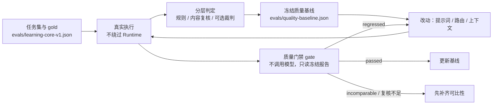

# 评测闭环：从发现问题到防回归

更新于：2026-11-16（Asia/Shanghai，UTC+08:00）。

评测模块本身在 [统一评测](evaluation.md) 和 [本机结果](evaluation-results.md) 里已经说明。本文只回答一个问题：**评测结果怎么回到开发过程，并防止改坏？**

## 一句话

评测不是"跑出一个分数"，而是"任务集 → 真实执行 → 分层判定 → 冻结基线 → 改动后重测并拦截退化"这条链路。**前四步原来就有，第五步在 2026-11-16 补上。**



## 五步分别做什么

1. **定义任务**：`evals/learning-core-v1.json` 有 28 组 / 56 回合，18 dev / 10 holdout。gold 标注证据目标、状态期望、数值检查；**holdout 不用于调优**。
2. **真实执行**：评测走正常 Runtime 提交，不直接生成答案。每次尝试的输入清单（协议组、页图/帧、命中的证据、摘要、注入记忆）随 operation 冻结——所以能区分"工具返回过"和"这次模型真的看到了"。
3. **分层判定**：规则 grader 判交付与证据位置；内容质量由开发 Agent 按 rubric 或可选模型裁判复核，逐条留理由与修订历史。**执行成功、证据命中、内容正确是三个独立字段**，不合成一个总分。
4. **冻结基线**：认可的一次真实评测固化为 `evals/quality-baseline.json`，只含指标、口径和来源，不含答案与课程素材。
5. **门禁拦截**：改动后重跑真实评测，`gate` 只读两份已冻结的 JSON，判断范围是否可比、复核是否充分、硬指标是否退化，并用退出码表达结论。

## 已经跑通的三次迭代（不是设计稿）

| 发现 | 证据 | 改动 | 重测结论 |
|---|---|---|---|
| 路由 v1 省 57% Token，但把追问也降级，内容复核掉到 **5/6**（把两个百分比说成分母相同） | `docs/evaluation-results.md` | 规定"存在历史回合时追问一律回 Agent" | 内容回到 **6/6**，仍省约 26% Token |
| 早期回答把 `inspect_page` 等内部工具名暴露给学习者 | 真实网页验收 | 改学生侧提示词 | 重新真实验收；**评测保留原始结果，没有用新提示覆盖旧证据** |
| 首次工具调用把文件名当资料 ID，白跑一次 `material_not_found` | 5 步 / 2 次失败的真实运行 | 系统提示规定 ID 只来自工具结果；错误文案给出下一步 | **重新真实运行**：4 步 / 0 失败，引用与图像数量不变 |

还有一个"评测阻止了错误结论"的例子：RRF 把 Hit@5 从 0.40 提到 0.60，但六对端到端核心条件没有显示内容正确性差异。于是文档只说"这套标注查询上召回提高"，**不说"RRF 让讲解普遍更好"**。

## 质量门禁怎么判

```bash
# 从认可的真实报告生成/更新基线（本地，需有 data/）
uv run python -m learning_agent.evaluation gate \
  --experiment data/evaluations/evaluation-pair-v1 \
  --snapshot evals/quality-baseline.json \
  --note '基线说明'

# 改动后：先刷新报告，再判定
uv run python -m learning_agent.evaluation report data/evaluations/my-new-run
uv run python -m learning_agent.evaluation gate \
  --baseline evals/quality-baseline.json \
  --experiment data/evaluations/my-new-run
```

| 结论 | 退出码 | 触发条件 |
|---|---:|---|
| `passed` | 0 | 范围一致、复核充分，交付/证据/内容均未退化 |
| `regressed` | 1 | 交付数、证据通过数或已复核内容通过数下降；或重大错误增加 |
| `incomparable` | 2 | suite/rubric 版本、变体或回合集合不同 |
| `insufficient_evidence` | 3 | 复核覆盖率低于阈值，或复核数少于基线 |

三条刻意的设计：

- **Fail closed**：范围不同或没复核，一律不算通过。宁可让人先补齐可比性，也不给一个虚假的绿灯。
- **不以平均分抵消退化**：一个条件从 pass 掉到 fail，不会因为另一个条件变好就被抹平；重大错误单列。
- **Token 和耗时只报告、不判定**：成本和速度不是质量。当前 provider 也不保证输出 token 上限，所以额度不是金额保证。

## CI 的分工

CI 里跑的是 `scripts/check_evaluation.py`：校验任务集结构（id、rubric 版本、split、turn、gold 唯一性与完整性）、基线 schema 与指标合法性、校准集与查询集非空。**不调用模型、不依赖被忽略的 `data/`**。

真实质量门禁**不进 CI**——它需要模型调用、课程素材和开发复核，放进每次 push 既不经济也不可靠。它是显式的、本地的命令，这才是这个项目的诚实边界。
