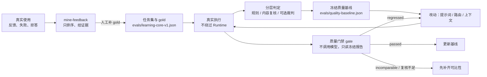

# 评测闭环：跑出来的结果怎么回到开发

更新于：2026-11-17（Asia/Shanghai，UTC+08:00）。

[统一评测](evaluation.md) 和 [本机结果](evaluation-results.md) 讲评测模块本身。这篇只讲一件事：跑完评测之后，结果去了哪里，下次改代码怎么知道有没有改坏。

前四步其实一直是这么干的，第五步 11 月 16 日补上，第六步（题从哪来）11 月 17 日补上。所以这篇更像一份补课记录，不是从头设计的方案。



## 六步都在干什么

1. 先把题出好。`evals/learning-core-v1.json` 里 28 组、56 回合，18 dev、10 holdout。gold 标了证据目标、状态期望和数值检查。holdout 留着，没拿来调参数。

2. 真跑，不抄近路。评测从正常 Runtime 提交，不直接生成答案塞进去。每次模型调用的输入清单（协议组、页图或帧、命中的证据、摘要、注入的记忆）跟着 operation 一起冻住。这样事后能分清楚：工具确实返回过，和这一次模型真的看到了，是两回事。

3. 分开判。规则 grader 看交付和证据位置，内容质量交给开发 Agent 按 rubric 复核，或者用模型裁判（要多花钱）。执行成功、证据命中、内容正确是三个字段，不揉成一个总分。

4. 把认可的那次结果冻起来，存成 `evals/quality-baseline.json`。里面只有指标、口径和来源，没有答案，也没有课程素材。

5. 改完东西再跑一次，`gate` 读两份冻好的 JSON 就能判：范围还能不能比、复核够不够、硬指标掉没掉。结论用退出码给出来，方便脚本接。

6. 题自己会过期。前五步只保证"改动没把已有的题做坏"，管不了"题本身偏了"。所以从真实使用里往回捞：用户点"这一步没懂"、写了卡点、运行失败、工具报错、回答里出现"资料里没找到"，这些都在 `mine-feedback` 的扫描范围里。

## 第六步具体怎么走

`mine-feedback` 只读 workspace，不发模型请求，也不写数据库。

```bash
# 看一眼值不值得捞
uv run python -m learning_agent.evaluation mine-feedback \
  --workspace data/demo/workspace \
  --output data/feedback/candidates.json \
  --since 2026-11-01

# 顺手导一份能直接喂给 run 的骨架
uv run python -m learning_agent.evaluation mine-feedback \
  --workspace data/demo/workspace \
  --output data/feedback/candidates.json \
  --suite data/feedback/cases.json
```

它干三件事，只有这三件：

- **排序**。反馈类型给先验分：`stuck` 4 分（用户明说没懂，当前讲法没解决卡点）、`restate` 3 分、`example` 2 分、`understood` 负分（对照组，价值低于失败样本）。运行状态再叠：`failed` 4 分、`interrupted` 和 `budget_exhausted` 各 2 分。另外有几个信号：已完成却没有 canonical 答案、完全没有工具观察却给出长答案、工具观察带 error、回答里出现拒答措辞。
- **去重**。扫 `evals/*.json` 里所有问题文本，归一化（去空白和标点）后比对。已经在集子里的扣 5 分沉底，并标出是哪个 case、哪个 turn。
- **给证据**。从实际运行的操作账本里取模型真看过的页和帧，转成 `evidence_targets` 草稿。图片排在文字前面。

它**不做**的，才是关键：不写 `required_concepts`，不写 `forbidden_claims`，不判定"这是一次失败"。导出的 case 里 gold 是空的，`needs_human_gold` 一直是 `true`。分数只用来决定先看哪几条，不是结论。

为什么不自动标：让模型给自己出题、自己判分，评测集就会被模型的偏好污染，几轮之后只会测出"模型还是那个模型"。这条线不越。

反馈类候选天生是两轮：被反馈的那次回答是一轮，反馈本身挂成下一轮（`target_turn` 指回第一轮）。这样重放出来就是"同一个没解决的卡点再问一次"，跟当时真实发生的一样。


## 真改过的三次

这几件事都不是设计稿，是实际发生过、又回头验证过的。

| 发现了什么 | 凭什么这么说 | 改了什么 | 重跑之后 |
|---|---|---|---|
| 路由第一版省了 57% Token，但把追问也降级了，内容复核掉到 5/6。错在把两个百分比说成分母相同 | `docs/evaluation-results.md` | 规定有历史回合时，追问一律回 Agent | 回到 6/6，还是省了约 26% Token |
| 早期回答把 `inspect_page` 这类内部工具名直接说给学生听 | 真实网页验收 | 改学生侧提示词 | 重新验收过；原来的评测结果留着，没用新提示去覆盖旧证据 |
| 第一次工具调用拿文件名当资料 ID，白跑出一个 `material_not_found` | 5 步、2 次失败的真实运行 | 提示词里写清 ID 只能来自工具结果，错误文案也给出下一步 | 重跑一次：4 步、0 失败，引用和图片数量没变 |

还有一种情况值得记一笔。RRF 把 Hit@5 从 0.40 拉到 0.60，看着挺漂亮，但六对端到端样本的内容复核没有显示出差异。所以文档里只写"这套标注查询上召回提高"，没写成"RRF 让讲解普遍更好"。评测在这里的作用反而是拦住了一个过度结论。

## 门禁怎么判

```bash
# 生成或更新基线，本地跑，要有 data/
uv run python -m learning_agent.evaluation gate \
  --experiment data/evaluations/evaluation-pair-v1 \
  --snapshot evals/quality-baseline.json \
  --note '基线说明'

# 改完之后，先刷报告，再判
uv run python -m learning_agent.evaluation report data/evaluations/my-new-run
uv run python -m learning_agent.evaluation gate \
  --baseline evals/quality-baseline.json \
  --experiment data/evaluations/my-new-run
```

| 结论 | 退出码 | 什么时候出现 |
|---|---:|---|
| `passed` | 0 | 范围一致、复核够，交付、证据、内容都没掉 |
| `regressed` | 1 | 交付数、证据通过数或已复核内容通过数下降，或者重大错误增加 |
| `incomparable` | 2 | suite/rubric 版本、变体或回合集合对不上 |
| `insufficient_evidence` | 3 | 复核覆盖率不够，或者复核数比基线还少 |

几个地方我刻意写得狠一点。范围对不上、复核没做完，都直接判失败，不给一个看着好看的绿灯。一个条件从 pass 掉到 fail，不会因为另一个条件变好就被抹平，重大错误单独算。Token 和耗时打印出来给人看，但不参与质量判定，何况当前 provider 也不保证输出 token 上限，那个额度本来就不是钱数。

## CI 只管不花钱的那部分

CI 里跑 `scripts/check_evaluation.py`，查任务集结构（id、rubric 版本、split、turn、gold 有没有缺或重）、基线 schema 和指标是否合法、校准集和查询集是不是空的。不调模型，也不依赖被忽略的 `data/`。

质量门禁我没放进 CI。它要模型调用、课程素材，还要开发复核，每次 push 都跑一遍既不便宜也不可靠。放在本地显式执行更实在。

## 说之前要交代的

基线只有 12 回合、3 个 Case，复核是开发 Agent 做的，不是独立人工金标准。它能当回归信号用，撑不起显著性结论。

那 12 回合里有 4 个是在实验预算下以 `budget_exhausted` 交付的，算"已交付"，但不算完整成功。`evidence_total=2` 的意思是这套任务里只有 2 个回合标了位置或模态证据目标，别讲成 12 回合都验了看图。也没有真人学习收益数据，评分不写掌握画像。

还有一块得说清楚。反馈回流现在有通道了，但没有真实外部用户：`mine-feedback` 扫的是这台机器上的使用记录，样本来自我自己试用，不是线上流量。所以能讲"机制跑通了"，不能讲"线上失败驱动了评测集"。想改这个口径，只能真找人用一段时间。

自动标注也没做，上面说过原因。候选落库成审核队列（pending / accepted / rejected）也还没做，现在 accepted 是靠人手动改 `evals/*.json`。
