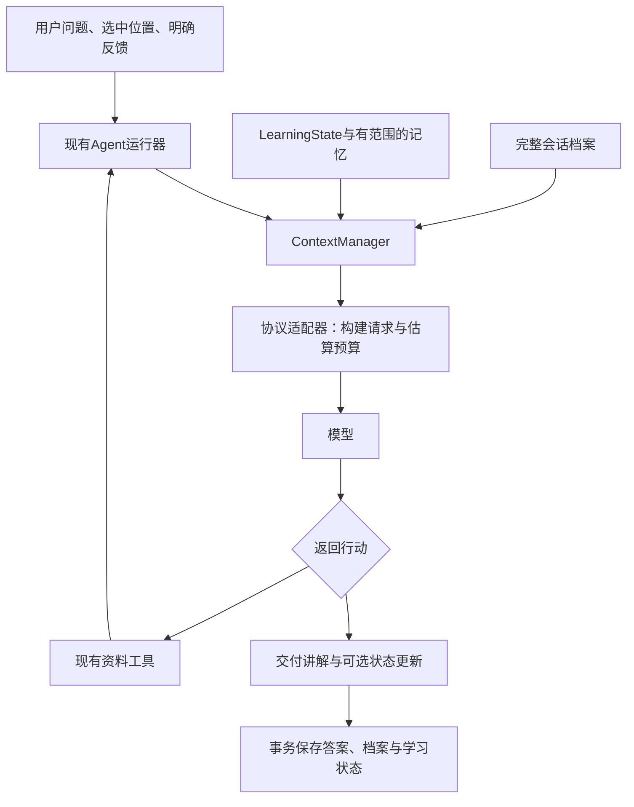

# 学习状态与上下文管理设计

状态：待实现。设计日期2026-10-19；更新时间2026-10-19 21:05（Asia/Shanghai，UTC+08:00）。代码基线为`a3c5e02`。本文描述目标行为和实施顺序，不代表当前已经具备长对话压缩或跨会话记忆。

## 1. 解决的用户问题

用户围绕课程连续提问时，Agent应记得当前困惑、已经尝试的讲法和用户的纠正；换到新主题后，不应被旧卡点牵着走。对话变长仍能继续，查看过的旧图片也不应每次全部重发。重新打开会话能接续学习，另建会话则可明确选择接续同一学习主题。

核心仍是讲清楚。记忆帮助Agent选择解释、补前提、核对资料或澄清，不强制每轮检索、压缩、测验，也不生成未经验证的“掌握率”。本轮不实现问答进程崩溃恢复、多用户账户或向量记忆数据库。

## 2. 现状与必须保留的行为

以下依据代码，不能用本文的设计覆盖实际完成度：

| 代码入口 | 当前行为 | 需要改进 |
| --- | --- | --- |
| `agent.py:run_turn` | 开始时拼接完整`conversations.protocol`与本轮问题；序列化超过100,000字符即停止 | 字符数不是输入token；工具循环内部继续增长时没有统一管理 |
| `store.py:learning_state` | 最近6条工作记录、8条反馈；发送模型前再取部分记录 | 没有明确学习目标、未解决问题或版本化状态 |
| `provider.py:step` | 适配Chat Completions与Responses；图片在调用时读取并编码 | 预算未覆盖实际协议体、工具定义、旧图片与输出预留 |
| `store.py:finish_run` | 答案、最终协议与学习笔记同事务保存 | 需要保留完整原始协议，同时另行构建有界上下文 |
| `messages` / `runs.events` | 前者保存用户与最终回答；后者保存工具观察、模型usage等 | 不能据此还原所有中间助手消息或Responses原生项目 |

保留既有约束：反馈必须绑定本会话有效回答；确认旧回答不覆盖新主题；失败仍保留用户反馈，不提交新工作判断；普通正文回退不编造学习记录；位置选中不等于实际查阅；模型内部思维链不展示。

## 3. 模块边界与调用位置



- `ContextManager`在**每次模型调用之前**准备上下文，包括工具执行后的下一步。它选择、压缩和组装，不替模型选择教学行动。
- `LearningState`记录当前会话的工作状态；`MemoryStore`管理明确范围内可跨会话使用的长期条目。二者不替代原始反馈。
- `Provider`先生成可估算的请求表示，再发送同一表示，避免估算对象与实际请求不一致。现有两种协议继续支持。
- `Store`保存原始档案、摘要来源和上下文选择记录。档案可回看；模型每次只收到本次选定的内容。

建议文件为`context.py`、`memory.py`；学习状态模型继续放`learning.py`，持久化沿用SQLite。无需为此引入LangChain/LangGraph，也不复制旧项目模块。

拟定内部接口：

```python
ContextManager.prepare(run_context, model_profile) -> PreparedContext
Provider.build_request(prepared_context, instructions, tools) -> ModelRequest
Provider.estimate(request, model_profile) -> BudgetEstimate
Provider.send(request) -> ModelStep
LearningState.apply(validated_patch, expected_revision) -> LearningState
MemoryStore.recall(space_id, selected_topic_id, query, budget) -> list[MemoryItem]
```

`prepare`与请求构建通过有界的本地调整过程协作，不能递归调用模型直到“预算合适”。预算不足与服务异常必须可终止。

`PreparedContext`是原始轨迹的派生视图，不能原位删改运行器持有的完整历史。模型返回的新消息追加到原始轨迹；调用时使用过的摘要与记忆版本另记在快照中，最终归档仍保留本轮实际发生的调用和观察。

## 4. 三种记录各司其职

### 完整档案

保存原始用户输入、明确反馈、当时选中位置、每轮完整模型/工具协议及资产引用。新增的系统注入内容独立标记为`derived_context`，不混进原始用户问题。重新准备时不再次复制旧的注入包，也不把旧摘要递归当作新用户事实。

压缩只改变下一次发送内容，不删除原始对话或图片产物，也不减少档案的磁盘占用。原始档案的导出、保留期与整会话删除另行设计。

### 会话学习状态

| 字段 | 含义及约束 |
| --- | --- |
| `revision` | 服务端递增版本；避免并发覆盖 |
| `goal` | 当前学习目标，可空；区分用户明确表达与Agent工作假设 |
| `active_topic` | 主题ID、短标题、适用资料ID；不能仅按同名词推断同一主题 |
| `confusion` | 当前具体卡点，附来源回合和判断类型 |
| `open_questions` | 有界的未解决问题列表，含提出/解决来源；没有反馈时不能自行标记用户已理解 |
| `attempts` | 指向既有学习笔记的近期讲法与关联反馈，不重复抄写全部答案 |
| `evidence_refs` | 需要接续查看的资料位置、版本及观察来源；不等于当前已重新查阅 |

所有可变事实附`source_run_id`与`origin=user_explicit / agent_hypothesis`；用户后续纠正优先于旧假设。反馈仍单独记录`target_run_id`：它更新对应回答的反馈关系；只有涉及当前主题时才改变当前卡点。用户切题后，旧卡点转为未解决项或由用户关闭，不挤占当前目标。

延伸现有`deliver_explanation`，增加可选、严格校验的`state_update`；保留原有`answer/topic/confusion/approach/reason`以兼容现有调用。状态补丁不接受模型指定其他会话ID、来源权限或任意SQL字段；版本由执行器绑定。已解决项必须提供用户明确反馈或实际复述证据，仍不外推整章掌握。

回答、学习笔记和有效状态补丁在同一事务提交。失败不更新学习状态；预算用尽只能保存已交付部分的状态，未完成事项仍开放。普通正文回退保留旧状态。用户直接修改状态独立提交，并使依赖旧版本的上下文失效。

### 跨会话记忆

记录适合复用的明确偏好、学习目标和主题内未解决事项，不把每轮对话全部转成永久画像。条目包含`id/kind/value/space_id/topic_id/material_ids/origin/source_run_id/revision/status`；同一键更新保留来源与替代关系。

默认不跨会话召回。用户在新会话选择“接续已有学习主题”后，按本空间、所选主题与资料范围召回；该选择持续生效，无需每轮确认。空间之间不自动互通；当前为本机单用户，不用虚构的用户ID冒充租户隔离。

用户明确表达的偏好可以在启用接续后保存；Agent推测先留在会话工作状态，需用户确认才成为长期有效条目。候选记忆先按范围与有效性筛选，再在预算内按当前问题相关性选择。初版用结构化筛选和文字匹配，不新增嵌入服务依赖；没有相关条目可以不召回。

用户可查看、修改、停用或删除。删除记忆会使依赖它的摘要和上下文缓存失效，旧注入包不能再次带回；拒绝继续使用的偏好需记录排除标记，自动摘要与召回也须遵守。原始聊天文字仍保留，界面明确区分“忘记此记忆”与“删除原始对话”。不得承诺记忆删除已清除所有原始数据或服务商日志。

近期原话若仍在输入中，须附对应条目已失效的标记；历史节选和摘要不能再把该原话提炼为当前有效偏好。用户明确询问过去说过什么时可以回看原文，但回看不重新启用记忆。

## 5. 上下文选择与压缩

### 预算针对真实请求

计算系统说明、工具JSON定义、文字、原生协议项目和图片成本，预留输出与误差空间。设配置的请求总预算为`C`，输出预留为`O`，安全余量为`H`，则估算输入需满足`I <= C - O - H`。整轮工具次数、时间和新增图片预算继续独立限制。

可将`C=32k、O=4k、H=4k`作为实施时的起始实验配置，**不是当前网关或模型窗口的已验证规格**。不根据`gpt-6.1-sol`名称猜上下文长度。模型配置档记录协议、服务地址标识、预算、估算器和窗口是否已验证；不存密钥。部署者可调小，超出实际服务限制时明确报错，不暗中无限重试。

有适配的tokenizer时用于文字估算；未知模型使用保守估算并标记不确定性，不能把字符/token比例称为精确值。图片计入数量、尺寸、编码体积和保守视觉额度；base64长度不等于视觉token。原生不透明项目计入成本上界，无法可靠估算时优先移出旧的完整组。用真实返回usage校准后续配置，不能用它倒推本次调用已经绝对安全。

输出预留还需按经过验证的协议字段限制实际输出；不同网关是否支持对应字段须验收。未支持时标记“仅预留、未强制”，不得宣称严格总token上限。编码前完成资产选择，避免每步把所有旧图片读取后再丢弃。

### 保留顺序与原子单位

1. 固定系统约束、工具定义、本轮原始问题和明确反馈；选中位置单独标记。
2. 反馈指向的具体步骤、相关回答内容与当前有效学习状态，保证“这一步”仍可解释。整篇旧回答太大时保留明确选区及足够邻接内容，标明节选；指代仍不明则澄清，不静默猜测。
3. 当前尚未完成的工具调用组、刚返回的观察和本次判断所需图像。
4. 最近完整对话、有关资料锚点和已确认相关记忆；删除无关或已被纠正的条目。
5. 更早历史用有来源的摘要代替。

不能简单按消息条数截尾。一个助手批次的工具调用、所有对应结果及其带标签图像组成原子组，ID必须匹配。当前未完成批次不得压缩；当前必要项已超过预算时，应收窄工具输出或提示用户缩小问题，不拆断工具对、不裁切公式到失真。

`Responses`的`provider_items`可能包含原生调用与不透明的加密推理项目，且当前适配器优先使用它。保留时保持整个批次原样；压缩时移除整个已完成批次，再用应用层摘要替代。不能修改规范化文本却留下覆盖它的旧`provider_items`，也不解密、改写或展示内部推理。跨模型/协议不直接复用原生项目，使用可见对话摘要和合法重新构建的消息。

### 摘要生命周期

- 仅覆盖已经完成的回合范围，记录`covered_turn_range`、来源ID、摘要版本、生成模型/策略和学习状态版本。当前运行中的工具轨迹不进入持久摘要。
- 内容限于用户目标、明确纠正、未解决问题、讲解尝试、来源锚点及不确定性；不是内部思考过程，也不复制整段检索结果。
- 按回合水位增量更新，相同覆盖范围不在每个工具步骤重新生成。不无限进行“摘要的摘要”；保存原始来源映射，发现矛盾时可从涉及的原始回合重建。
- 摘要模型请求单独计费、限时与限输出，计入本轮成本和总时限；输入同样先做预算。优先确定性构建状态与索引，达到预算压力才请求语义压缩，不能额外调用成为每轮固定开销。
- 摘要输入视为数据；输出用严格结构校验并核对来源ID、范围与字数。失败不覆盖有效旧摘要，改用有界近期完整组、必要状态和明确节选；仍放不下就可解释地停止，不循环请求摘要。

摘要是帮助接续的二手记录，不能将其标记为原资料已核实的事实。回答需要精确公式、数字或归因时，Agent仍可用现有资料工具重新查阅。

## 6. 多模态与来源约束

图像预算分为“每轮新增查看上限”（沿用现设置）与“本次模型输入保留上限”（新增）。旧图片不会因曾看过就永远保留：保留当前相关画面，旧画面可从输入移除，留下资料、位置与历史观察标识；原资产不删除。当前必要工具组的图像在下一次决策前保持可用，不能刚看完即被压缩掉。

历史图像移除必须通过协议安全的组变换完成，不能破坏调用/结果配对。再次讨论其视觉细节时，Agent通过现有`inspect_page/inspect_media`重新附加，产物可复用，但实际重发仍计入图片与请求预算。去重逻辑需区分“重复无进展调用”与“图像已移出输入后的合法重新附加”，避免当前`seen`把恢复视觉上下文误判为死循环；同轮重新附加次数仍受预算限制。

来源锚点采用版本化结构：`material_id + content_revision + location + observation_run/event_id + modality`。位置包含PDF物理页/区域、文字行号或当前媒体时间；媒体原始文件、字幕和来源时间映射分别记录适用版本，字幕替换不应假装旧字幕仍有效，也不必误删原媒体画面记录。

必须区分：检索候选、已读文字、历史看过图像、本次实际有图像、用户选中位置。跨会话召回的锚点仅是待查位置，不直接获得当前会话的可验证来源资格；需实际调用工具核对后再接入现有引用解析。当前引用解析依赖真实工具观察，这条规则保留。记忆中的旧答案也不能成为证明课程原文的依据。

需要恢复被压缩的用户原话时，增加有界的只读`recall_learning_context`工具：限本会话档案，或用户已选择接续的主题关联会话；按已知回合ID读取可见用户/助手原话，返回来源与节选状态，不返回隐藏推理、任意空间资料或全库搜索结果。模型不必每轮调用它；它不替代资料查阅。

## 7. 存储、迁移与界面

| 持久化对象 | 主要内容 |
| --- | --- |
| `protocol_turns`（新增） | 每轮新增的原始协议及原子组索引、原始问题/派生注入边界、模型/协议版本；用回合序号关联，不重复归档整段前史或base64 |
| `learning_states`（新增） | 会话ID、版本化状态、更新时间；已有反馈与笔记表继续作为来源 |
| `context_summaries`（新增） | 覆盖范围、结构化摘要、来源映射、策略与状态版本、失效标记 |
| `learning_topics`（新增） | 空间内稳定主题ID、用户可修改标题和资料范围；会话设置保存可空的接续主题ID |
| `learning_memories`（新增） | 空间/主题范围、类型、值、来源、版本与状态，包括遗忘排除标记 |
| `context_snapshots`（新增） | 每次调用选中的组/记忆/摘要版本、移除原因、预算估算、图片数与实际usage；避免重复存正文 |

使用schema版本迁移，现有`messages`、反馈和笔记不删。新回合在`finish_run`中原子归档；运行中仍使用内存协议与现有事件日志。上下文快照是诊断记录，**不是可恢复执行检查点**，不能解决API进程被杀后的问答恢复。

旧`conversations.protocol`可能把工作记录拼进用户内容，也有模拟用户角色的图片消息。不得靠`role=user`机械分回合。迁移时先保留完整旧协议为legacy档案；能无歧义识别的完整组建立索引，识别不了的部分整体保留，不伪造丢失的中间协议。首次需要压缩时，以可验证的`messages`、反馈、笔记和工具事件生成注明局限的旧会话摘要；原生不透明项目不能跨模型强行重建。迁移不要求用户新建会话，也不以摘要覆盖原档案。

拟定接口：扩展现有`GET /api/conversations/{id}/learning`，保留原返回字段，增加`state/revision`；用`PATCH`同一路径提交用户更正并校验版本。`GET/POST /api/spaces/{id}/learning-topics`列出或创建主题，`PATCH /api/conversations/{id}/context-settings`设置或取消接续；`GET /api/spaces/{id}/memories`按主题列出记忆，`PATCH/DELETE /api/spaces/{id}/memories/{memory_id}`修改或遗忘。服务端校验空间、主题与会话关系。`GET /api/runs/{id}/context`返回精简诊断，不含密钥、base64或隐藏推理。

网页延伸现有学习记录面板，展示“当前目标/卡点、已尝试讲法、仍待解释的问题”，可修改或清除工作状态；新建会话时可选择接续主题。跨会话记忆单独列出来源和删除入口。普通用户无需理解token；调试详情才展示压缩范围、估算误差、图片移除及使用过的记忆。

## 8. 实施顺序与验收

### M1：每次调用前管理预算与协议组

先归档/索引协议组、拆分用户原话与派生注入，再接入Provider请求构建和预算估算、上下文快照、旧图像淘汰与重新附加。用确定性保留/节选作为失败退路；暂不开放跨会话记忆。现有100,000字符防护在新路径完成验证后才替换，不直接删除。

验收工具循环中也能触发预算管理、多工具结果不孤立、Responses原生项目不残留覆盖、图片移除后可恢复、失败时不损坏原始历史。两种协议做离线契约测试；真实网关验收仅对实际可用协议宣称通过。

### M2：可追溯摘要与学习状态

实现摘要覆盖水位、严格校验、失败退路与版本化状态；扩展交付工具和学习记录面板。补充有界的历史原话读取。现有反馈、普通正文回退和老主题确认行为必须继续成立。

使用相同课程问题构造20–30轮连续学习：局部不懂、换讲法、用户纠正、切换主题、反馈旧回答和引用早期图表。人工对照原资料复核解释是否连贯、纠正是否保留、有无无关旧卡点和虚构来源；同时记录输入usage、图像数、额外摘要费用与延迟。与未压缩的可执行短前缀对照，超长时记录旧实现停止，不能伪造无限上下文基线。

### M3：有范围、可管理的跨会话记忆

实现主题接续、记忆范围筛选与用户增删改，验证新会话接续和独立学习均正常。换空间、同名不同主题、用户更正、记忆删除、字幕替换应触发相应隔离或失效；旧注入/旧摘要不得复活已停用记忆。观察长期偏好是否真正改善解释，不以“记忆命中率”代替回答质量。

验收报告分列工程正确性、模型行为、人工内容复核与真实用户反馈。测试通过不等于用户学会；先完成可用闭环，再据真实问题调整预算和摘要策略，不围绕单个分数反复局部调参。

## 9. 后续扩展边界

后续问答持久化执行应复用这些档案ID和状态版本，但另行保存步骤、外部调用结果与恢复策略；多用户部署还需身份、权限、租户隔离及记忆删除策略。二者不塞进本轮模块，也不因为有数据库就宣称已经具备。
