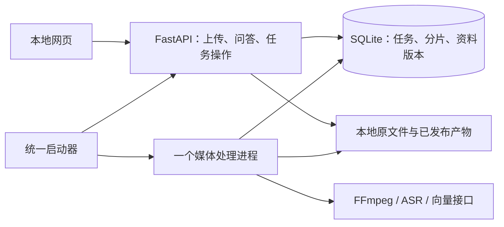
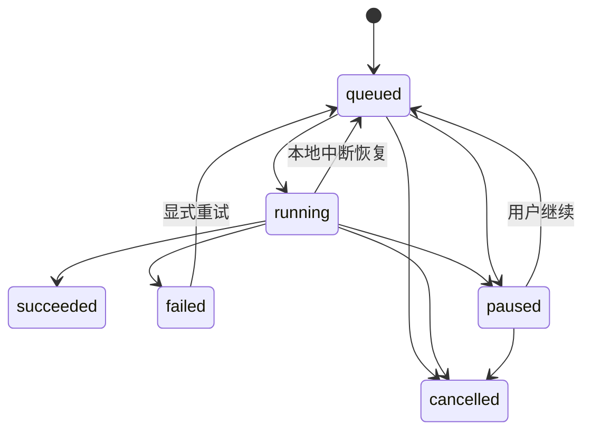

# 完整课程导入、任务恢复与首次使用设计

状态：**分阶段实施中，A/B已落地**。原始代码审查基线为 `47742f6`，第1节保留该基线的问题。任务与产物底座、分块导入、分片ASR恢复已实现，见[后台任务说明](background-jobs.md)与[整课验收](long-course-acceptance.md)。当前默认上限2 GiB/4小时，实际验收87分钟英文与102分钟中文课程；统一启动和首次向导仍待实现。尚未实现的设计内容不代表已上线。

目标用户是在本机学习公开课程、讲义和个人资料的人。目标流程是：启动网页 → 配置可用模型 → 导入整节课及讲义 → 看懂处理进度 → 提问、反馈和回听；处理中断后可以接续已有成果。媒体加工的依赖顺序服务于资料可用性，讲解时仍由Agent选择阅读、看图、核对来源或补讲。

## 1. 代码审查结论

| 实际位置 | 当前行为 | 设计要解决的问题 |
|---|---|---|
| `app.py:upload` | `file.read(limit+1)`，媒体100 MB；文件内容以bytes传给Store | 大文件内存随文件大小增长；需直接落盘 |
| `media.py:probe` | 时长上限3600秒、最高4K | 87/102分钟的真实课程不能原样导入 |
| `media.py:prepare` | 整体转码，固定600秒超时 | 长课可能超时，没有可读进度或原子发布 |
| `media.py:transcribe` | 整段解码到临时WAV；本地ASR读完整波形，兼容API按60秒请求 | 本地内存随时长增长，中间转写结果不能恢复 |
| `Store.recover_media` | 将processing/running改为失败，提示重试 | 能发现中断，不能续接完成部分 |
| `Retriever.prepare` | 向量批次已保存；运行状态在进程内字典 | 可以复用完成向量，缺持久任务与故障状态 |
| 启动入口 | 手工准备`.env`、依赖，再执行uvicorn | 新用户需理解环境和能力组合；没有统一入口 |

已经完成的播放器、来源偏移、检索、引用、学习反馈及会话记录继续作为基础。README提供当前使用入口，功能边界以实际代码和验收结果为准。

## 2. 产品流程与可用状态

上传完成后出现资料卡，不等待全部转写完成才返回网页。分别展示：

- **原文件**：上传中、检查中、已接收、需要处理问题。
- **回放**：准备中、可回放、准备失败；不把转码中间文件开放给播放器。
- **字幕**：未提供、等待处理、转写中、已就绪、已暂停、需要重试。
- **检索**：文字可检索、语义索引准备中、混合检索就绪、关键词检索可用。

用户可先读讲义和问答。字幕未就绪时，Agent仍可以看实际页面/抽样帧，但不能解释未取得的讲话。后台进度不是教学步骤，不要求每次提问等待所有可选能力。

已有字幕优先使用。上传本身不自动触发云端转写或云端向量费用；导入确认页列出将运行的步骤，用户可勾选“生成字幕”“准备语义检索”，显示已配置的服务和数据发送范围。确认后的任务自动继续，中断恢复不反复要求相同授权；远端结果不明的请求另行处理。

本阶段先支持本地文件导入。公开课程下载提供明确准备步骤；网页任意视频网址下载留待后续按来源适配，避免把外部平台下载成功作为基础学习路径的前提。

## 3. 运行结构

启动器管理一个API进程和一个处理进程，默认监听127.0.0.1；本阶段面向单用户本地运行。SQLite保留任务事实，处理进程可退出、重启，网页刷新不影响处理。CPU较重的转码/本地ASR默认串行，减少与问答争抢资源。

同一数据目录由一个启动器持有操作系统文件锁，防止重复启动两套处理进程。启动器确认旧处理进程退出后才恢复任务；正常退出同时回收FFmpeg子进程。SQLite领取任务使用短写事务，执行FFmpeg、模型推理和网络请求时不持有数据库事务。配置WAL与有限busy timeout，仍按单写者设计，不据此宣称多写并行。[SQLite事务说明](https://sqlite.org/lang_transaction.html)、[WAL说明](https://sqlite.org/wal.html)。

API的`create_app()`仅初始化应用和数据结构，不再负责把媒体任务标成中断；恢复归处理进程启动负责。单独运行uvicorn时已有资料问答可用，后台处理入口明确显示处理进程离线，提示使用统一启动器。开发测试显式驱动任务，不依赖TestClient隐式等待BackgroundTasks完成。

## 4. 完整课程导入与上传协议

### 4.1 初始目标

计划默认单份媒体最多 **2 GiB、4小时、最高4K**；PDF与文字暂沿用现有上限。这是待验收的产品目标，设置项允许按机器调整。提高文件上限必须与落盘上传和分片ASR同时上线，不能让旧的整文件/整波形读取继续承接大文件。

网页按8 MiB顺序发送原始二进制块，API通过请求流写入工作目录；服务端按实际接收字节限制大小，不仅检查Content-Length。[Starlette请求流说明](https://starlette.dev/requests/)提供了相应接口；实现按项目锁定依赖验证，不直接依赖最新文档才增加的限制参数。

### 4.2 拟定接口

| 接口 | 含义 |
|---|---|
| `POST /api/spaces/{space}/uploads` | 声明文件名、大小和格式，返回upload_id、块大小与已确认偏移 |
| `PATCH /api/uploads/{id}` | 携带Upload-Offset提交下一块，返回已确认偏移 |
| `GET /api/uploads/{id}` | 查询已确认字节、总字节、状态及归属空间 |
| `POST /api/uploads/{id}/complete` | 校验已收字节，固定material_id，提交探测任务；重复调用返回同一资料/任务 |
| `DELETE /api/uploads/{id}` | 取消未完成上传并释放其临时文件；不等于删除已发布资料 |

单个upload串行写入，同偏移并发请求不能双重追加；偏移不符返回409和服务端偏移，客户端先查询再继续。文件块落盘并同步后才提交数据库中的确认偏移。崩溃留下的未确认尾部在续传前截去，避免把部分写入当作完整块；数据库确认偏移是恢复依据。

原始文件在同一数据目录内原子移动到资料目录。完成请求到登记资料之间采用固定material_id及可重入的完成步骤：若移动已完成而登记未提交，重试继续登记；不会重新复制大文件或创建第二份资料。

刷新后浏览器可能需要用户重新选择原文件；文件名、大小、修改时间用于辅助匹配，不声称能证明内容相同。不确定是否同一文件时提供重新上传入口，不默认把另一份文件接在旧文件后。初版不引入全文件哈希去重或全局资产索引。

检查格式、时长、可用轨道后完成收录；失败显示具体可操作原因。空间不足时暂停并保留已确认成果，用户可取消释放上传临时文件；不自动删除用户原文件或成功产物。临时数据清理提供可见操作，不在启动时静默清空可续传内容。

### 4.3 回放与时间轴

一个原文件始终对应一个material_id和从0开始的完整播放器时间轴。内部ASR切片不变成多份用户资料，原视频来源偏移继续在此时间轴上叠加。保留当前每次`inspect_media`最多120秒的观察范围，支持小时级引用。

回放优先使用本机浏览器支持的原文件；需要调整容器时尝试无损重封装，其他情况生成统一H.264/AAC预览。是否可直接播放通过实际格式和浏览器验收判断，不能仅凭`.mp4`后缀认定兼容。预览输出到临时文件，成功退出并检查有效轨道/时长后原子发布；抽帧仍可从原文件读取。

读取FFmpeg实际编码进度，展示处理到的媒体时间，进度最多先到99%，通过产物检查后才标为完成；预估剩余时间需明确是估算。[FFmpeg进度接口](https://ffmpeg.org/ffmpeg.html)采用key/value输出，解析`out_time`或明确单位的时间字段，不把`out_time_ms`凭名称当成毫秒。

预览阶段首次采用单次转码，不承诺在任意编码帧续接。中断后重做该预览阶段；已完成字幕、向量和原文件保留。由此维持完整连续播放，避免把独立AAC片段简单拼接造成时间漂移。

## 5. 持久任务、状态与恢复语义

### 5.1 数据结构

沿用workspace.db，增量增加：

| 表/记录 | 关键内容 |
|---|---|
| `uploads` | 空间、固定资料ID、声明大小、确认偏移、状态、相对路径 |
| `jobs` | 类型、空间/资料、输入版本、配置摘要、状态、尝试次数、当前阶段、进度、暂停/取消请求、脱敏错误 |
| `job_parts` | job_id、片段/批次序号、源时间范围、状态、成功结果或结果路径、错误、尝试次数 |
| `transcript_revisions` | 候选转写版本、来源、完整度及激活状态 |
| media/index状态 | 已发布能力与其版本，供播放器、检索和工具查询 |

产物路径带任务/输入版本，先写临时文件再原子落盘，最后提交数据库完成状态与激活指针。若在文件成功落盘与数据库提交之间崩溃，恢复时核对该版本产物及结构，再补提交，避免再次调用API或转码；仅有残缺临时文件则重做该分片。取消或版本已失效的任务即使留下产物也不能激活。

配置摘要包含服务、模型、参数和切分方案，不在任务表保存API key。失败重试复用相同输入/配置的成果；切换转写模型或切片方案创建新任务版本，不混用此前模型的分片。旋转密钥而不改变模型/接口时可用现有本机配置重试。

同一资料、处理类型、输入版本仅有一个活动任务；重复点击返回已有任务。索引任务包含资料版本与编码器标识，不会误用旧字幕向量。

### 5.2 状态机

状态外另存`pause_requested`/`cancel_requested`，网页显示“等待当前分片结束”。本地ASR在片段边界响应暂停；转码可终止当前FFmpeg并保留其他阶段。已发出的云端请求不能靠取消承诺撤销费用。

默认不自动重发失败的云端操作；显示错误、已完成分片和重试入口。连接中断后远端是否已处理无法确认时标注`remote_result_unknown`，提示重新请求可能再次计费。执行与持久提交之间也存在崩溃窗口，不宣称外部API调用exactly-once。

| 阶段 | 恢复单位与承诺 |
|---|---|
| 上传 | 服务端已确认的文件块 |
| 探测 | 重跑轻量文件探测，不重传原文件 |
| 回放准备 | 复用成功预览；中断重做整个预览阶段 |
| 本地ASR | 复用已保存分片；只重算未完成分片 |
| 云端ASR | 复用本地已保存结果；远端状态不明须明确重试含义 |
| 知识分段 | 同一字幕版本可重建，不触发再次转写 |
| 语义索引 | 复用已提交向量批次；缺失批次继续生成 |

回放与字幕准备是独立能力；字幕完成不必等预览转码，已有字幕不必运行ASR。语义索引依赖已发布文字/字幕，未配置向量时BM25仍可用。任务进度分别呈现，不把各阶段随意加权成准确的“总完成百分比”。

## 6. 有界内存ASR与时间一致性

本地ASR初始采用5分钟核心区间，兼容API沿用约60秒核心区间；两端各加最多5秒解码上下文，尾片按实际媒体时长裁剪。每次只解码/加载当前区间的16 kHz单声道PCM，临时音频留在`data/jobs/{job_id}/`，成功结果及时落盘入库。内存随分片大小与模型规模变化，不随整课时长线性加载波形。

时间换算始终使用解码窗口在完整文件中的起点，而非简单累加已处理片段长度。记录核心区间、解码区间、原始ASR时间及必要的有效范围裁剪。恢复不会把后半节课程重新从0计时。

带上下文切片仍可能在边界产生断句、漏词或重复。按段落时间中点归属核心区间，保留跨界标记。整课实验发现“整句/句尾”分段差异后，去重补为：仅跨分片、时间重叠的完全相同文字，或令牌严格包含且时间区间也包含的重复片段；保留去重说明，不用语义相似度猜测删改术语。不保证所有边界准确对齐，实际讲话重复、术语错识别与漏词需独立复核。兼容API未提供词时间戳时，不伪造逐词定位。

无语音分片可保存合法的空结果并标为已处理，不永久重试；接口缺少时间片段字段或返回未分段文字属于不兼容错误，不能冒充静音。整课未识别到语音时展示“未识别到讲话，可上传字幕”，任务结束但不声称已有可用讲话内容。

所有分片完成后，在短事务内切换活动字幕版本并更新资料revision；此前的成功字幕在候选转写期间保持可用。初次转写期间不把局部候选当作全课字幕公开给检索；网页展示已处理时长，讲义学习仍可继续。内部ASR分片、检索段落和五分钟导航分组是不同用途，不把它们称为自动识别的课程语义章节。

用户上传新字幕时，新版本原子激活，并取消/废弃旧转写候选的发布；运行中的旧任务不能覆盖用户字幕。索引任务发布时同样核对输入版本。修改原始来源网址/偏移只更新映射元数据，后续可复用未变的文本向量；首个实现允许明确失效重建，不以此阻塞核心恢复功能。

## 7. 首次启动与配置向导

入口计划为仓库根目录的`./start.sh`，内部启动Python管理器。首次检测uv、兼容Python环境及锁定依赖；缺少系统工具时给出当前系统的具体安装指引，不静默安装全局软件或下载大型ASR模型。

启动网页后，向导按能力逐项显示：

| 能力 | 设置与检测 |
|---|---|
| 文字/工具调用 | 当前支持协议、base URL、model、key；可选择官方地址或兼容网关 |
| 看图 | 独立检测按钮，使用生成的测试图；不能由文字请求成功推断视觉可用 |
| 视频处理 | FFmpeg/ffprobe是否可用；缺失时说明视频入口暂不能处理 |
| 无字幕转写 | 本地CPU或兼容服务，展示模型是否需要下载；也可先使用自带字幕 |
| 多语言语义检索 | 本地Ollama或兼容向量接口；未配置时明确提供BM25能力 |

首次可先完成文字/PDF学习；Ollama和GPU不是启动前提。界面区分“已填写配置”“检测通过”“检测失败”，不将key非空作为服务可用证明。文字、视觉、ASR、向量分别检测；涉及网络生成、下载或上传测试材料的操作由用户明确触发，说明可能计费，不发送用户课程做默认探针。

密钥只写本机被忽略的`.env`，后续GET不返回明文；保存保留已有无关设置并原子替换，文件权限按当前本地系统收紧。配置写接口校验本地Host和同源Origin，默认服务不开放公网。

新配置在受控重启后生效；运行中的提问/任务使用已确定的配置。向导请求应用配置时，先让本地任务到达暂停点并等待当前问答结束，再重启，不能在ASR分片间静默切换模型。任务恢复沿用相同配置摘要；改模型则创建新候选版本。

停止启动器会保存任务状态并结束受管进程；重新启动接续本地未完成任务。上次中断的问答明确标为未完成、解除会话占用，不自动重发讲解请求；已完成回答与学习记录保留。媒体任务恢复和问答重试在界面上区分。

## 8. 接口迁移与模块拆分

新增`jobs.py`处理任务状态与数据访问，`worker.py`执行阶段/分片，`uploads.py`实现上传会话，`launcher.py`负责本地生命周期，`setup.py`提供向导配置/能力检测。`media.py`拆出单区间转写与有进度的子进程执行；Store保留空间、资料及原子激活入口；Retriever接入持久任务状态，继续复用已有向量缓存。

计划任务接口：`GET /api/spaces/{space}/jobs`、`GET /api/jobs/{id}`、`POST /api/jobs/{id}/pause|resume|retry|cancel`。返回当前阶段、已完成/总片段、实际已处理时长、可重试原因与处理进程是否在线。所有任务和上传操作检查所属空间，错误不暴露密钥或原始上游响应。

现有小文件上传、字幕上传、转写、准备索引入口保留为兼容适配：创建同一套任务，不再启动另一套BackgroundTasks。新网页媒体使用分块上传；PDF/文字可保持有界的小文件路径。已有ready媒体、字幕、会话与引用无需重新生成；旧processing/running任务无法复用过去已消失的临时成果，迁移后从首个尚无成功产物的阶段开始。

播放器与Agent工具继续使用material_id及完整文件的相对时间，不把job_id或ASR片号暴露为学习资料引用。旧媒体状态字段通过任务/已发布能力投影保持兼容，持久任务成为处理状态的事实来源。

## 9. 实施顺序与交付标准

| 顺序 | 可交付结果 | 验收条件 |
|---|---|---|
| A：任务与产物底座 | SQLite任务、单处理进程、阶段状态、原子发布与中断恢复 | 中断后成功产物仍可用；重复提交不创建重复任务；旧字幕不会被旧任务覆盖 |
| B：整课接收与分片转写 | 分块落盘、小时级时间轴、有界ASR、持久结果 | 87分钟英文及102分钟中文原课可完整导入，无需手动截短；跨分片回听正确 |
| C：启动与网页引导 | 统一启动、独立能力检测、进度与暂停/继续/重试 | 新环境能跟提示配置；没有Ollama也可完成文字/PDF学习；重载页面恢复状态 |
| D：完整演示与文档 | 固定课程案例、失败恢复演示、使用说明和私有研究记录 | 导入→提问→暴露误解→补讲/复述→回听完整走通，公开文档明确已实现边界 |

A是B/C的实现依赖，不扩展为独立调度平台。各步完成后做对应验证，再进入下一步；不反复扩展局部调参。

真实验收复用本机已下载的完整官方课程；中文课程可先用公开字幕走整课导入，再在连续自然语音区间验收本地ASR边界。英文完整课进行实际分片转写。另用生成的长文件做大体积上传/内存验证，但生成文件不计作教学效果证据。

必查场景：上传中断后的确认偏移；ASR完成多个片段后强制终止进程再启动；转码中断不暴露半成品；向量接口失败后继续；新字幕替换旧任务；无音轨、无语音、磁盘不足；两次启动同一数据目录；任务进行时API仍能响应资料与普通提问。

边界验收选多个实际ASR切分点的前后片段回听，并覆盖课程后半部分及超过60分钟的引用。报告记录原始/各轨道时长、已复用分片、实际重复API请求、处理耗时、API/处理进程峰值内存、最终引用及人工内容复核。验收内存重点是没有整文件/整波形加载，比较相同设置下30分钟与完整课的峰值；不在尚未测量前承诺固定速度或RAM数字。

工程恢复通过后再组织真实使用者体验，检查能否完成首次导入和连续学习。自动化工程测试与模拟反馈套件分别记录，不宣称已证明真人学习收益。
